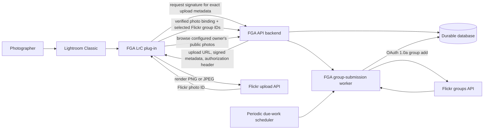

# Architecture overview

Last updated: 2026-09-11

Status: Derived overview; not an independent normative source

Authority: Derived overview. Apply [the documentation authority hierarchy](README.md),
then the cited accepted ADR or scoped contract.
[ADR 0050](decisions/0050-select-cloudflare-and-evaluate-native-storage-first.md) selects Cloudflare and evaluates
Durable Objects and D1 first; RDS PostgreSQL is the fallback.
[ADR 0051](decisions/0051-trust-private-storage-runtime-with-guarded-writes.md) accepts native SQL
guards with a trusted storage-owning runtime for the private deployment.
Permanent suppression, hostile-client checks, transaction safety, and recovery
remain required; broad native schema capability alone does not require RDS.

## Recommendation

Build one FGA LrC plug-in as both an original Lightroom Classic publish provider
and an add-only queueing client for existing public photos in the configured
owner's Flickr account, regardless of uploader or Lightroom Classic catalog
binding, backed by a hosted queue service. Do not try to patch Adobe's installed
Flickr publisher.

This recommendation is driven by two requirements together:

- The Lightroom SDK permits a publish provider to render PNG, while Adobe's
  Flickr provider exposes a JPEG-oriented workflow.
- An FGA group-submission worker must retain enough authorization to add photos
  to groups after the Lightroom Classic host process has closed.

Adobe's installed provider is a compiled `Flickr.lrplugin` binary, not a Lua
source package with a supported extension point. The SDK's Flickr sample is old
reference code, not the installed production provider. The governing Adobe
Developer Terms permit development/test use but do not permit Adobe Lua source
to be sublicensed and distributed as FGA's public MIT source. An original
implementation against documented SDK callbacks gives FGA a clear technical
and licensing boundary.

## Logical components

The editable [system architecture diagrams.net source](diagrams/system-architecture.drawio)
adds one explicitly non-selected Google Cloud deployment candidate and a
second-page walkthrough of the safety-critical group-add path. It is a derived
visual, not an independent normative source.

The FGA API backend signs exact Flickr upload metadata while the FGA LrC plug-in
streams the local rendered file directly to Flickr. The successful Lightroom
Classic probe established this boundary without routing large PNG files through
the FGA API backend.

## Photo intake and publish flow

The FGA LrC plug-in exposes two explicit intake paths. The original-publisher
path follows the render and upload flow below. The existing-photo path does not
render or upload again; it selects an existing public photo from the configured
owner's Flickr account through the documented
[existing public Flickr photo intake contract](existing-public-photo-intake.md)
and joins the flow through one common verified photo binding. The FGA API
backend verifies exact identity, Flickr ownership, public visibility, and the
current linked-account revision without requiring a Lightroom Classic catalog
binding. Both paths use the same add-only and fail-polite backend invariants.
ADR 0008 records the hybrid scope and ADR 0021 records the intake and
authority boundary.

The [non-destructive existing-photo boundary](non-destructive-existing-photo-boundary.md)
and ADR 0022 keep that queue-only path distinct from a Lightroom
Classic published-photo record, Flickr album membership, and pixel identity.
Discovery or binding never imports the photo into an FGA published collection,
moves it between albums, replaces it, deletes it, or uploads a new copy.

1. The FGA LrC plug-in acts as a Lightroom Publish Service provider. The
   photographer right-clicks the service, chooses **Create Album…**, adds
   culling candidates to that native published collection, and later dispatches
   selected work or the album's pending work. This is the observed baseline,
   not a requirement to preserve Adobe's exact menus or click sequence; ticket
   #0065 owns the complete capability inventory and efficiency challenge. For
   each photo with an FGA-recorded photo-binding ID, the FGA API backend derives
   the Flickr photo ID from that binding and performs a fresh
   `flickr.photos.getAllContexts` read and the plug-in shows current Flickr pool
   membership separately from groups selected to add. Each user-created
   ordinary FGA published collection corresponds one-to-one with one Flickr
   album, and every newly published photo must eventually be attached to that
   album. The [album-scoped publish
   contract](album-scoped-publish-contract.md) defines hosted binding identity,
   first-photo materialization, per-photo obligations, lifecycle, and repair.
   The FGA LrC plug-in exposes neither smart albums nor a default publishing
   collection.
2. The FGA LrC plug-in persists zero or more editable per-photo group-addition
   selections. ADR 0045 maps this behavior to one
   `LrLibraryMenuItems` command, a native `LrDialogs.presentModalDialog`, and an
   untitled `LrMetadataProvider` string field scoped inside each photo by the
   FGA publish-service and Album local identifiers. For a previously published
   photo with newly selected groups, it hands only those group IDs and the
   common hosted photo binding to the hosted API; it does not render or upload
   the image again. For an unpublished photo, the photographer separately
   clicks Publish.
3. At publish time, the FGA LrC plug-in treats each photo as independent and
   durably snapshots that photo's zero or more selected group IDs before
   requesting a render from the Lightroom Classic rendering engine with the
   publish service's settings. PNG is the preferred output; JPEG is an explicit
   fallback if chosen by the user or required by a size policy. The run does
   not promise cross-photo render, upload, handoff, or completion order.
4. After preflighting the rendered file, the plug-in obtains a fresh signed
   envelope, uploads directly to Flickr, and receives a Flickr `photoid`.
5. The FGA LrC plug-in adds the Flickr photo ID to its durable local recovery
   record, calls the documented Lightroom SDK to record it in the Lightroom
   Classic catalog as the remote publish ID, ensures eventual attachment to the
   published collection's Flickr album, obtains the common hosted photo binding,
   and, when groups were selected, sends its binding ID, current verification
   revision, and the complete bounded group set through one idempotent batch
   operation. The FGA API backend derives the Flickr identity from the binding
   and creates one durable intent per selected group. Upload, binding, album
   attachment, and any group handoff are not one atomic operation.

Zero group additions are a valid publication choice. The normal single-photo
preflight makes **No group additions** explicit; an empty choice in a
multi-photo callback neither blocks that photo nor opens serial modal dialogs.
It creates no group-submission intent or worker work. The FGA LrC plug-in does
not send an empty group-submission batch merely to obtain hosted photo proof;
ADRs 0011 and 0021 define the two intake proofs and their common
binding. ADR 0010 is authoritative for this product rule.
[ADR 0045](decisions/0045-use-a-library-modal-and-photo-metadata-for-group-selection.md)
defines the exact documented-SDK selector and local record.

Flickr's documented photoset-creation method requires a primary Flickr photo
ID. An empty FGA album therefore exists only as a Lightroom Classic published
collection until the first real photo upload succeeds. The first successfully
bound real photo materializes the Flickr album, and the FGA LrC plug-in records
the returned opaque remote collection ID and URL through documented Lightroom
SDK methods. No component creates a placeholder photo. Creation is never
replayed after an ambiguous result; later attachment uses fresh exact
membership to distinguish completion from a safe bounded add attempt.
ADRs 0025, 0026, and 0029 record those decisions.
6. The FGA API backend validates and commits the complete batch transaction
   before acknowledging the plug-in. It performs no Flickr write inline and
   emits at most one post-commit partition hint, never one hint per group.
7. The canonical-lowest newly eligible partition may use that immediate hint.
   Other newly due partitions, and any intent behind an older head, remain
   durably scheduled in the FGA database.
8. A scheduled sweep runs at least once per minute and wakes only partitions
   whose exact database due time has arrived. A worker advances a partition in
   order until it reaches a throttle, transient failure, safety bound, or an
   empty queue. The nightly response to Flickr code `5` is a later per-partition
   due time, not the scheduler's only cadence.

Flickr is authoritative for current group-pool membership. The FGA API backend
refreshes that display from Flickr whenever the selector opens for an
already-published photo; it does not infer current membership from FGA intent
history. The result is a timestamped observation and can become stale
immediately. The FGA LrC plug-in and FGA API backend expose only group
additions: current memberships are read-only, deselection has no removal
meaning, and no FGA API backend path calls `flickr.groups.pools.remove`.

Writable-group discovery uses one bounded FGA refresh worker job per attempt,
one atomically replaced current snapshot, and revision-checked keyset pages.
Fresh per-photo membership observations use the same stateless paging shape.
The [group snapshot and pagination
contract](group-snapshot-and-pagination.md) defines fixed budgets, truthful
stale/failure behavior, and the `409` restart boundary. ADR 0030
replaces page-level work items, retained generations, and stored random cursors.

A Flickr `getAllContexts` response becomes an observation only after the FGA
API backend validates the complete JSON root, `stat: "ok"`, an explicit array
for the repeated `pool` member, and every pool object's bounded ID/title fields.
A missing, null, non-array, partially malformed, duplicated, truncated, or
over-budget collection is `membership_observation_unavailable`, publishes no
snapshot or partial groups, and cannot enable group-addition confirmation. Only
a fully validated explicit empty array means no current pool memberships were
observed. The plug-in/service contract owns the exact shape and fixture matrix.

The FGA group-submission worker independently repeats that strict membership
read for the exact photo immediately before each possible add attempt. A cached
selector snapshot is never write authority. An unavailable observation retains
the intent at its FIFO head for a bounded safe-read retry and sends no
`getInfo` or add request. A successful observation of the exact target group
terminalizes the intent as `added` with source
`pre_add_membership_observation`, without sending a write. Only a complete
successful observation in which the target group is absent permits the worker
to continue to the moderation preflight. The read is still advisory: external
membership can change after Flickr answers.

Flickr upload, album attachment, hosted photo proof, and any group-intent
creation cannot be one atomic transaction. The plug-in therefore needs a local
recovery/outbox record: if upload succeeds but a later applicable operation
fails, it must retry only that safe operation without uploading the photo again.

The complete multi-photo publish run is eventually consistent, not atomic or
ordered. Each photo progresses and reports status independently; a failed or
ambiguous photo does not stop later healthy photos merely to preserve Lightroom
Classic publish-run order. No work may disappear silently: it continues toward
its intended result or reaches a durable state explaining why safe automatic
progress is impossible. Per-group FIFO begins only when an intent is durably
inserted and is not a cross-photo publication-order guarantee. ADR 0009 is the
authoritative decision.

The direct Flickr upload is not idempotent from the FGA LrC plug-in's
perspective. Once it invokes `LrHttp.postMultipart`, the documented Lightroom
SDK contract does not prove that zero request bytes left the Lightroom Classic
host networking stack. A timeout, connection loss, or missing definitive Flickr
result therefore creates an `upload_outcome_unknown` recovery record; the FGA
LrC plug-in does not replay the image POST. Only a failure proven before that
invocation may start a new request, and it obtains a fresh upload authorization.

## Queue model

“One queue per `(user, group)`” is a behavioral guarantee, not necessarily a
physical cloud queue for every pair. A relational model is likely simpler and
cheaper:

- `users`: FGA identity, Flickr NSID, credential reference, status.
- `groups`: Flickr group ID and short-lived display metadata.
- `group_partitions`: `(user_id, group_id)`, committed next-enqueue counter,
  exact next-work time, wake revision, fenced lease generation/expiry, next
  probe time, and last result.
- `submission_intents`: unique `(Flickr photo ID, Flickr group ID)`, validated
  user/partition key, immutable monotonically ordered enqueue value, status,
  attempt count, timestamps, last Flickr result, and any later positive
  pool-membership observation.
- `submission_blocks`: permanent unique `(Flickr photo ID, Flickr group ID)`
  do-not-resubmit facts, first reason, first observation time, and source
  attempt. “Photo added to the pool's pending queue” (code `6`), “photo already
  in the pool's pending queue” (code `7`), and ambiguous post-dispatch outcomes
  create them.
- `attempts`: retained operational history including the fresh
  `ispoolmoderated` preflight value/time, immutable `dispatch_started` marker,
  zero-byte-proof classification, and result state, with secrets and sensitive
  request material excluded.
- `flickr_write_gates`: durable `enabled` or `paused` state, revision, and
  sanitized current cause for each linked user and for the deployed Flickr
  application.
- `flickr_write_gate_events`: append-only pause, failed-repair-check, and resume
  history with correlation IDs and no credentials or signed request material.

Only one FGA group-submission worker may hold a partition lease at a time. The
durable `submission_intents` relation retains terminal rows for idempotency,
history, and status inspection; retaining a row does not retain active queue
membership. The active FIFO comprises exactly `queued`, `attempting`,
`retrying`, and `throttled` intents. Its head is the active member with the
lowest immutable enqueue value. `added`, `moderation_submitted`,
`delivery_uncertain`, `needs_attention`, and `cancelled` intents are terminal
and excluded from the active FIFO.

Every terminal transition atomically removes active queue membership while
retaining the durable row and history. A `throttled` or safely retryable head
remains active and blocks later intents in its partition. A filtered or partial
database index over queue-bearing states is the conventional implementation;
the worker must not scan or step over terminal rows to find the head.

The FGA API backend exposes owner-scoped read-only intent collection/detail
resources to the FGA LrC plug-in and separately authenticated mirrors to the
FGA administrative control plane. They report the exact durable intent state,
advisory position within its one group partition, due time, shared gate holds,
latest allowlisted outcome, and permanent-block/attention projection. A status
read makes no Flickr call and cannot schedule, retry, reopen, cancel, reorder,
clear a gate, or remove a block. `active`, `attention`, and retained `history`
views use stateless immutable-created-key pages; they promise an observation,
not a queue snapshot or ETA.
[ADR 0034](decisions/0034-expose-read-only-group-submission-status.md) and the
[group-submission status API contract](queue-status-api.md) define the wire,
copy, polling, and conformance boundary. The
[moderator-safety UI conformance
contract](moderator-safety-ui-conformance.md) requires selector, status,
repeated-batch, and administrative views to derive protected-pair copy and
available actions from the server-owned permanent block through one fail-closed
priority rule.

Every client, including a future browser, admits one photo's complete bounded
group selection through the same batch route. The FGA API backend registers no
single-group create alias, rejects invalid or over-limit batches before writing,
and never lets the request handler loop through immediate Flickr attempts. One
transaction may make several partitions due but emits at most one immediate
partition hint; the scheduled sweep recovers every other due partition.
ADR 0020 records the courtesy and conformance boundary.

The FGA database serializes committed enqueue ordinals by locking each affected
partition row. Claims use an expiring database-clock lease plus a monotonically
increasing generation as a fencing token; every worker mutation conditions on
that generation and its opaque lease ID. Immediate queue messages carry only a
partition hint and wake revision, confer no authority, and may be lost because
an at-least-once-per-minute database due sweep is the recovery path. No database
transaction remains open during a Flickr call. The
[worker persistence and scheduler contract](worker-persistence-scheduler-contract.md)
and [ADR 0015](decisions/0015-database-fenced-worker-scheduling.md)
define the schema constraints, transactions, lease recovery, and crash cases.

Suggested intent states:

The canonical visual form is the
[photo-to-group add state machine](diagrams/photo-group-add-state-machine.puml).

- `queued`
- `attempting`
- `throttled`
- `retrying`
- `added`
- `moderation_submitted`
- `delivery_uncertain`
- `needs_attention`
- `cancelled`

`added` and `moderation_submitted` complete FGA's requested action. The latter
does not assert that the item is still pending or will be accepted; its precise
UI meaning is “submitted for moderation; final decision unknown.”
`delivery_uncertain` is also terminal for automatic processing, but is not
success: politeness requires the FGA group-submission worker to stop because
repeating a possibly delivered write could create another moderation event.
Flickr can also return conditions that make success impossible without human or
external change, so
`needs_attention` remains necessary.

Terminal intent state is not the permanent safety boundary by itself. A
`submission_blocks` row survives ordinary intent-state changes, reconciliation,
cancellation, and history pruning. Every code path checks that row before an
outbound group-add write.

It also survives arbitrarily long group-moderation cycles. A group may be
moderated, become unmoderated while its volunteer moderator takes a multi-month
break, and become moderated again when that same person returns. The returning
moderator may remember rejecting the photo. Neither the intervening
`ispoolmoderated="0"` period nor elapsed time authorizes the FGA API backend or
FGA group-submission worker to resubmit a pair that ever reached moderation.

This enforcement belongs to the FGA API backend, FGA group-submission worker,
and FGA database. The FGA LrC plug-in cannot supply moderation metadata, clear a
block, or request a bypass. Treating the client as potentially buggy, modified,
or hostile prevents the official FGA API backend from being weaponized against
volunteer moderators, including Terry if he volunteers as a moderator in
retirement.

The exact-pair block cannot stop distinct-photo spam. Public or multi-user
signup remains out of scope until a separate abuse threat model defines and
tests conservative user/group admission limits, outstanding-intent caps, rate
limits, monitoring, suspension, and re-registration resistance for the
official FGA API backend and worker deployment.

## Flickr group result policy

Before **every** possible individual `flickr.groups.pools.add`, the FGA group-
submission worker first performs a fresh strict `flickr.photos.getAllContexts`
read for the exact photo. It sends no add when that read fails or is incomplete.
When the target group is absent from a complete observation, the worker then
performs a fresh `flickr.groups.getInfo` call. A cached result from either read
is insufficient. It durably records both observations with the attempt, then
sends the write only if both reads succeeded and the moderation value is
interpretable. This exceptionless invariant applies to scheduled, immediate,
manual, administrative, recovery, and test paths.

Before the membership read, the FGA group-submission worker atomically reserves
global Flickr rate-limit capacity for the membership GET, moderation GET, and
possible add POST. It never waits for rate capacity between them. Capacity for
operations proven unnecessary is released exactly once.

The FGA group-submission worker uses monotonic elapsed time and begins
dispatching the POST less than 1,000 milliseconds after receiving the
successful preflight response. If the observation reaches that age while the
worker records it or schedules local work, the worker discards it and performs
another preflight. The stored UTC timestamp is for audit, not the freshness
decision.

The preflight informs the FGA group-submission worker and its user; it does not
make the two Flickr calls atomic. A group can switch moderation between GET and
POST. “Photo added to the pool's pending queue” (code `6`) after a preflight
value of `0` is recorded as a moderation race or upstream inconsistency, then
handled exactly like every other confirmed moderation submission. No FGA
component can bound network transit or Flickr's server-side processing
interval; ADR 0007 records Terry's acceptance of that unavoidable residual
race.

Classification for `flickr.groups.pools.add` application results:

| Flickr status | Code | FGA handling |
| --- | --- | --- |
| Photo added | `stat="ok"` | Terminal `added`; advance queue |
| Photo already in pool | `3` | Idempotent terminal `added`; advance |
| User has added the maximum allowed photos to the pool | `5` | Set partition `throttled`; stop until next scheduled probe, which begins with a new preflight |
| Photo added to the pool's pending queue | `6` | Create permanent block; terminal `moderation_submitted`; advance |
| Photo already in the pool's pending queue | `7` | Create or confirm permanent block; terminal `moderation_submitted`; advance |
| Service currently unavailable; write operation failed due to a temporary issue | `105`, `106` | Back off; retain head position; perform a new preflight before retry |
| Login failed or invalid OAuth token; user not logged in or insufficient permission | `98`, `99` | Pause that linked user's Flickr write gate; require reauthorization or permission repair |
| SSL, signing, or application-key failure | `95`, `96`, `97`, `100` | Pause the deployment Flickr write gate; require operator repair |
| Invalid, ineligible, moderation-rule, or external group block | `1`, `2`, `4`, `8`, `10`, `11` | Terminal `needs_attention`; no automatic retry |
| FGA format, method, or protocol defect | `111`, `112`, `114`, `115` | Pause the deployment Flickr write gate; terminal `needs_attention` if an add POST was sent |
| Request-policy failure | `116` | Terminal `needs_attention`; no automatic retry |
| Semantics not classified | Unknown code | Create permanent block and terminal `delivery_uncertain` if an add POST was sent; pause the deployment Flickr write gate |

Flickr's numbers are application result codes in the response body, not HTTP
status codes. The FGA group-submission worker must parse Flickr's `stat` plus
numeric code even when the HTTP exchange itself succeeded.

Every call must also pass through a global API-key rate limiter. Flickr's
developer guide currently says integrations should remain under 3,600 queries
per hour in aggregate across the key.

## Systemic Flickr write circuit breaker

The FGA database holds one durable Flickr write gate for each linked FGA user
and one for the deployed Flickr application. The gate is shared by the FGA API
backend and every hosted FGA worker; a process-local breaker is insufficient.
`enabled` and `paused` are the only states. A pause survives process restarts
and deployments and is separate from submission-intent state.

One definitive scoped Flickr result pauses the narrowest known fault domain:

- codes `98` and `99` pause the linked user's gate;
- codes `95`, `96`, `97`, `100`, `111`, `112`, `114`, and `115` pause the
  deployment gate; and
- an unknown numeric application code pauses the deployment gate because the
  deployed classifier is incomplete.

The breaker has no failure threshold. Photo-, group-, request-, pair-, and
temporary results retain their narrower policies; codes `105` and `106` remain
bounded-backoff results and code `116` remains request-specific.

An FGA group-submission worker checks both applicable gates after acquiring a
partition lease and again in the database transaction that would commit
`dispatch_started`. A paused gate releases the lease without changing the
intent's enqueue order, attempt count, or due time and sends no Flickr request.
Scheduler queries exclude paused scopes. A failure found during the read-only
`getInfo` preflight pauses the gate and retains the active head. A scoped result
received after the add POST keeps its existing per-intent terminal policy while
also pausing the broader gate. Other untouched partition heads remain queued.

The FGA API backend also refuses to issue a new signed direct-upload
authorization or initiate another hosted Flickr write while either applicable
gate is paused. It may continue to accept durable group intents; accepting work
does not start a Flickr write. Read-only status and the one explicit repair
verification remain available.

The FGA administrative control plane reports the paused scope, sanitized cause,
pause time, affected queue count and oldest age, and a correlation ID. It
deduplicates repeated observations behind the same pause revision. The FGA LrC
plug-in can show that repair is required but cannot clear or bypass a gate.

No pause expires automatically. To resume, the operator repairs or replaces the
credential or deployment configuration and requests a server-side check of the
same gate revision. The FGA API backend makes a fresh, signed, non-mutating
`flickr.auth.oauth.checkToken` call with the exact repaired configuration,
requires the expected Flickr owner NSID and at least `write` permission, and,
for a request-builder or classifier defect, also requires the corrected
deployment's conformance result. A compare-and-set transaction records the
repair evidence and actor before enabling that revision. A concurrent new
pause defeats the resume. Normal bounded scheduling and global rate limiting
then release due work without rewriting intent states or FIFO order.

The gate prevents new starts; it cannot recall a Flickr request already
dispatched by another worker or by the Lightroom Classic host networking stack.
Those operations retain their ordinary result and ambiguity handling.
[ADR 0013](decisions/0013-durable-flickr-write-circuit-breaker.md) records the
complete rationale and contract.

## Retry behavior

- Immediate work is an optimization, never the durability mechanism.
- A timeout or transport failure does not itself authorize replay. Read-only
  FGA API requests may follow their operation-specific keyset or cursor rules.
  A mutating FGA API request may be repeated only when its contract explicitly
  makes the operation idempotent and the caller preserves the same resource or
  natural key, request body, and authenticated owner. This rule never
  authorizes replay of the direct Flickr image POST after
  `LrHttp.postMultipart` was invoked.
- Use bounded exponential backoff with jitter for failures proven to occur
  before Flickr could receive the HTTP request and for Flickr's explicit
  “service currently unavailable” (code `105`) and “write operation failed due
  to a temporary issue” (code `106`) statuses. Every retry performs a new
  `getInfo` preflight.
- Before dispatch, durably mark the attempt `dispatch_started` so recovery has
  an explicit uncertainty boundary.
- If that marker exists, no durable record proves that zero add-POST request
  bytes could have left the FGA group-submission worker, and the FGA database
  lacks a definitive documented Flickr result, create a permanent block and
  terminal `delivery_uncertain` state. Apply the same block to an unknown Flickr
  application code. Neither the FGA API backend nor FGA group-submission worker
  retries the pair.
- A nightly probe is intentionally conservative for opaque group limits. Its
  exact database due time is stored per partition and discovered by the normal
  periodic sweep, so the policy can later become adaptive without a second
  scheduler.
- Process a bounded number of items per lease to avoid monopolizing workers and
  to remain comfortably within the Flickr API-key limit. Account for the
  mandatory metadata GET before every group-add POST.
- Record every state transition and Flickr error code for diagnosis.
- Accept Flickr's “already in pool” response as terminal `added` and “already
  pending” as terminal `moderation_submitted`, but do not assume that makes an
  ambiguous write generally retry-safe. A moderator can reject the first
  submission before a retry.

Flickr exposes no documented submitter-facing pending/rejection query. A later
positive pool-membership observation can establish that a moderation
submission was accepted. Absence cannot distinguish still pending from
rejected, never clears the permanent block, and never authorizes another add.
This is the [fail-polite decision](decisions/0007-fail-polite-group-submissions.md).

## OAuth and upload boundary

Flickr uses OAuth 1.0a with HMAC and SHA1-160 and requires write permission for
upload and group submission. Unlike OAuth 2.0 public-client flows, request
signing uses both the application's consumer secret and the user's token
secret.

Three implementation choices were evaluated:

1. **FGA API backend proxies uploads.** The secret stays on the API backend,
   which uploads to Flickr. This is simplest cryptographically but sends every
   large PNG through FGA infrastructure, increasing bandwidth, duration, cost,
   and exposure.
2. **Plug-in signs uploads locally.** The image goes directly to Flickr, but a
   shared consumer secret cannot be kept secret in an MIT-distributed Lua
   plug-in. Requiring each installation to supply its own Flickr API key may be
   acceptable for a personal/developer tool but is poor general-user UX.
3. **FGA API backend signs a direct upload request.** Flickr's upload spec says
   the binary `photo` field is excluded from the OAuth signature. The API
   backend issues fresh OAuth parameters and a signature for one multipart POST
   while the FGA LrC plug-in streams the bytes directly to Flickr. Python and
   Lightroom probes validated the split, including a successful full-resolution PNG
   upload through `LrHttp.postMultipart`. Flickr rejects changed signed
   metadata but accepts reuse of the same header during the observed timestamp
   window. The binary photo is not signature-bound, so the header is reusable
   bearer material and must be used immediately without persistence or logging.
   This is the selected boundary.

Regardless of upload choice, the FGA group-submission worker must securely
access the user's OAuth access token and token secret for later group
submissions. Encrypt credentials at rest with a managed key service, exclude
them from logs and traces, minimize access, and support revocation. Flickr's own developer
guide cautions that a centralized token store is an attractive target; this
risk must be explicit in the threat model.

The FGA LrC plug-in must not generate security-sensitive random values. The
Lightroom SDK has no documented secure-random source, and predictable Lua or
machine values are not acceptable substitutes. The FGA API backend generates
installation credentials, OAuth nonces, request identifiers, and any future
pairing codes using an operating-system-backed secure generator. For the private
MVP, the API backend generates exactly 32 random octets, encodes them as ADR
0044's 64-character canonical grouped Crockford Base32 Plugin Code, and retains
only its SHA2-256 digest and state. The FGA administrative control plane
displays the plaintext once for transfer through the same-workstation private-
window ceremony. With Windows clipboard history and cross-device sync disabled,
Terry copies the value once, pastes it directly into the FGA LrC plug-in's
transient Plugin Code input, and compares the simultaneous clear-text values in
identical grouping and typography. The FGA LrC plug-in strictly validates the
canonical spelling and stores it with `LrPasswords`. Terry then overwrites the
current clipboard with non-secret text and closes the private browser window.
The flow creates no file, password-manager record, URL secret,
chat message, device/claim code, polling endpoint, local callback, or QR image.
Lightroom Classic catalog object UUIDs remain
non-secret identity only. The FGA LrC plug-in displays the administrative
credential-generation URL but does not launch or control a browser, exchange
data with one, or receive a callback from one. See ADR 0006,
[ADR 0018](decisions/0018-same-workstation-private-credential-transfer.md), the
[private installation credential transfer ceremony](private-install-credential-transfer.md),
accepted
[ADR 0044](decisions/0044-use-canonical-crockford-base32-plugin-codes.md), and
the [zero-state publish flow](zero-state-publish-flow.md). The
[Future Terry FAQ](future-terry-faq.md) provides the cold-return explanation.

After storing the credential, the plug-in validates it with
`GET https://flickrgroupaddr.com/api/v001/installations/current`.
It supplies the secret through the LrC SDK's documented request-header table as
`Authorization: Bearer <FGA installation credential>`; it never places the
secret in the URL, query string, or body. The request has no body, versioned
device type, or profile query. A current match returns `200 OK` plus a minimal
current-installation representation with exact active installation and
`presentedCredentialState: "current"`; only then does the FGA LrC plug-in mark
its FGA connection authenticated. The same safe resource may report
`pending_rotation` for a later candidate without granting normal-route
authority. The read creates no session or replacement token; every later API
call presents and independently authenticates the installation credential
again. ADR 0032 records this resource boundary and the version-neutral
`lrc_plugin` internal class.

The FGA database separates the stable installation identity from revisioned
credential versions. An active installation has exactly one current normal-
route credential and at most one 15-minute current-installation-read-only
rotation candidate.
Planned annual rotation stages the candidate under a second fixed
`LrPasswords` key. The plug-in proves it can retrieve the candidate through the
safe resource read; Terry's recent-authenticated administrative POST then
atomically promotes it and retires the old version before the plug-in observes
`current` and moves its local key. A lost response or process restart resumes
from the candidate key and authoritative administrative state, never from the
now-possibly-revoked old value. There is no interval with two credentials
authorized for normal routes.

Administrative revocation invalidates the installation and every current or
pending version in one FGA database transaction. The FGA API backend rechecks
the exact version/revision inside every state-changing API transaction, so a
rotation or revocation that commits first defeats stale authority. It cannot
recall a response or upload envelope already returned or cancel group intents
already accepted. Lost and suspected-compromised workstations use server-first
revocation plus a wholly new installation identity; the control plane never
claims it erased an inaccessible endpoint secret.
[ADR 0019](decisions/0019-revisioned-installation-credential-lifecycle.md) and
the [installation credential lifecycle](installation-credential-lifecycle.md)
define the states, races, repair, audit, and conformance gate.

Authentication errors follow RFC 6750 instead of an FGA-specific split. A
malformed request envelope is `400 invalid_request`; absent authentication is
`401` with a bare Bearer challenge; and every malformed, unknown, inactive,
expired, revoked, disabled, or verification-failing token is the same
nonspecific `401 invalid_token`. `403 Forbidden` is reserved for a credential
that authenticated successfully but lacks permission for the requested action
or resource. Token syntax alone never counts as authentication.

Each installation row stores a non-null `credential_class`; the private MVP's
only recognized value is `lrc_plugin`. The FGA API backend matches that value
through an exhaustive class-to-route/method allowlist on every request. Null,
corrupt, retired, differently cased, and future unknown classes take an
explicit `401 invalid_token` branch. No request field creates or overrides the
stored class, and no default maps an unknown value to browser, administrator,
or another client authority. The database constraint,
runtime rejection, forward-version/rollback sequence, and regression matrix
are defined in the
[plug-in/service contract](plugin-service-contract.md#credential-class-and-fail-closed-authorization).

The LrC 15.3 SDK documents `LrHttp` caller-supplied headers and shows an
`Authorization` header in its example. It documents parsing received cookies
but no persistent browser-style cookie jar or `HttpOnly` isolation guarantee.
The FGA LrC plug-in therefore uses the conventional authorization header instead
of adding manual Lua cookie storage and replay that would gain no `HttpOnly`
protection.

The stored verifier is the unsalted SHA2-256 digest of the complete opaque
credential. The credential has no appended HMAC tag because it carries no
claims to authenticate, the FGA API backend still requires the database for
status and authorization, and a tag would not protect a stolen bearer
credential. A salt would not materially strengthen a unique 256-bit random
secret and would complicate direct digest lookup. ADR 0006 records both rejected
alternatives.

This provisioned object is an installation identity, not a distinct or
pre-approved plug-in binary. The standard plug-in may be downloaded and
installed before or after the administrator creates that identity; it simply
cannot authenticate until the credential has been transferred and stored.
This one-time friction replaces temporary device/user codes, browser approval
binding, client polling, expiry and rate-limit handling, and one-time redemption
logic. A smart-TV-style device flow would normally tell the user to open a
browser on another device rather than make the plug-in launch one. FGA's private
MVP needs neither that device flow nor a host-browser callback flow.

## HTTPS route ownership

The FGA HTTPS edge serves browser assets and hosted handlers on one origin, so
server ownership is resolved before any static-file or administrative-shell
fallback. Exact `/api/v001` and prefix `/api/v001/` always reach the FGA API
backend, including unknown API paths. Exact `/admin/login`, exact
`/admin/google-login`, and `/admin/flickr-oauth/callback` reach their FGA hosted
handlers before browser assets or client-side navigation. Accepted ADR 0043
requires route registration plus the derived inventory to carry that exact URI
before implementation. An unsupported HTTP method still reaches
the server owner and cannot fall through to HTML.

The hosted implementation derives one versioned route inventory from its route
registrations. Development and deployable asset-router matchers consume that
inventory or the same typed registry; they do not maintain another `/auth` or
`/oauth` list. One required gate validates both artifacts and then black-boxes
the real development topology and an isolated provider preview for the exact
build. Handler unit tests, expected-routing fixtures, or a provider simulator
alone cannot pass it.

No executable route-conformance pass is claimed while this repository has no
hosted router or provider configuration.
[ADR 0016](decisions/0016-derived-route-conformance.md) and the
[HTTP route and asset-router conformance contract](operations/http-route-conformance.md)
define the generated inventory, mandatory probes, evidence binding, and
rollback gate.
[ADR 0050](decisions/0050-select-cloudflare-and-evaluate-native-storage-first.md)
selects Cloudflare. The implementation must prove this route precedence through
the actual Cloudflare development and preview asset routers. Superseded ADR 0033
and the hosted deployment document preserve the historical Google Cloud proposal.

## Administrative control plane

The private MVP has one administrator: Terry's exact allowlisted, validated
Google `sub`. [ADR 0039](decisions/0039-use-google-identity-services-browser-sessions.md)
selects direct Google Identity Services authentication. GIS posts a Google-
signed ID token plus matching cookie/body `g_csrf_token` values to the FGA
Google Login Endpoint. The endpoint verifies the double-submit pair, validates
the assertion with a maintained Google authentication library and the FGA
backend's current Google JWKS cache, and uses only validated `sub` as stable
Google identity. The FGA database maps canonical Google issuer plus `sub` to one
opaque internal `fgaUserId`, which FGA-owned resources use as their ownership
key. It never treats email, profile fields, Flickr identity, source
network, or an FGA installation credential as administrator identity and does
not implement local passwords, reset, signup, roles, or invitations.

The private MVP exposes no device-link start, device code, public signup, or
self-service OAuth-login route. The Internet-reachable FGA Google Login
Endpoint is bounded before JWT validation by shared per-source and deployment-
wide limits. Outside login requests, the FGA JWKS refresh worker updates the
shared cache by the earlier of six hours and Google's metadata-driven freshness
deadline. The GIS CSRF check precedes ID-token processing; only an admitted,
CSRF-checked login naming an unknown signing key ID may wait for one bounded,
coalesced refresh. Flickr's separate OAuth callback remains single-use and
state-bound.
The FGA HTTPS edge supplies the trusted normalized source attribute, and the FGA
API backend stores only an expiring HMAC using a SHA2-256 limiter key. Limiter
failure refuses login/callback work without affecting authenticated plug-in
traffic. The administrative contract defines the accepted initial values and
evidence gate.

[ADR 0004](decisions/0004-single-user-mvp.md) makes later audience expansion
explicitly phased. The owner-only MVP remains first. An invite-only closed beta
may follow only after a separately accepted multi-tenant, abuse, privacy,
support, Flickr-terms, and cost design. Public signup for otherwise eligible
Google Accounts may follow only after closed-beta operational evidence and a
separate accepted go/no-go decision. The FGA Google Login Endpoint proving a
Google identity does not itself admit that identity in any phase.

After validation, the FGA API backend creates an opaque 256-bit server-side FGA
browser session. Its `__Host-fga_admin` cookie is `Secure`, `HttpOnly`,
`SameSite=Strict`, path `/`, has no `Domain`, and has `Max-Age=86400`. The FGA
database uses `SHA2-256(token)` as the one-way lookup key and stores
`fgaUserId`, validated `sub`, only required profile fields, and explicit FGA
session metadata—never the token, Google ID token, or complete decoded claim
map. Identity mapping, session creation, and the sanitized successful login
audit commit atomically before the cookie is returned. The session has the
same non-sliding 24-hour absolute lifetime and no shorter idle timeout. Each
unsafe method also requires an exact-origin check and an independent session-
bound 256-bit synchronizer CSRF token; CORS is disabled. Accepted
[ADR 0043](decisions/0043-use-transaction-bound-google-session-reauthentication.md)
and the [browser-session lifecycle](browser-session-lifecycle.md) bind rare
sensitive mutations to a five-minute, nonce-bound Google assertion for the same
account, rotate the current session, and explicitly do not claim a fresh factor
or phishing-resistant challenge.

Current-session logout commits its revocation and audit event before returning
a no-store `204` that expires the host-only cookie. The FGA administrative
control plane immediately scrubs its rendered data when Terry selects sign out,
but a timeout, lost response, or server failure remains **sign-out
unconfirmed** and retains the cookie for one idempotent retry. Closing the
private-browsing context clears local cookie state but does not prove server
revocation; another authenticated session may inventory and revoke the orphan,
which otherwise reaches the 24-hour absolute expiry. The detailed state
machine is in the [OAuth and account
lifecycle](oauth-and-account-lifecycle.md#logout-outcome-and-recovery).

If the hosted stack uses Django, each FGA API backend process loads its
independent framework-signing key through one exact selected managed-secret
version before serving traffic. That framework key does not sign, derive, or
verify the opaque FGA session token; the FGA database digest lookup is the
session verifier. The provider-specific candidate remains in the proposed
[session-signing key contract](operations/session-signing-key.md).

The operator-only administrative API is an explicit allowlist beneath
`/api/v001/admin/`: deployment status, session status/inventory/revocation/
logout, Flickr link status/authorization/disconnection, Flickr write-gate
status/verified resume, read-only group-submission intent status, and bounded
audit reads. The ordinary FGA User UI lists, creates, and revokes its owned
installation credentials through `GET`/`POST /api/v001/plugin-codes` and
`PATCH /api/v001/plugin-codes/{pluginCodeId}` under ADR 0040; those routes are
not in the administrative namespace. The FGA API backend exposes no generic database console,
secret viewer, arbitrary Flickr call,
group-pool removal, permanent-block deletion, force-resubmit, terminal-state
rewrite, private-MVP account-deletion route, or credential-type bypass. The
Flickr application key and consumer secret enter the FGA managed secret store
through the hosting provider's authenticated deployment control, not a browser
form.

Only current Flickr-link authority without a replacement pause can resolve
its exact active credential generation. Relink must prove the immutable expected
Flickr owner NSID and at least `write` permission. The provider-versioned path
stages before activation; [ADR 0052](decisions/0052-evaluate-paused-native-credential-replacement.md)
accepts evaluating paused native bundle replacement with generation checks and
repair instead of guaranteed old-grant rollback. Neither path automatically
resumes a paused write gate. A local disconnect atomically
removes that authority and pauses new operations before managed-secret cleanup.
Flickr exposes no documented application-side token-revocation API, so the UI
separately reports local deletion, stopped FGA operations, and the owner action
needed to use Flickr's **Remove Permission** control. It never calls local
deletion remote revocation.

Disconnect, relink, and session/credential revocation preserve permanent
photo/group submission blocks, dispatch ambiguity, intent and upload-binding
history, gate events, and audit. The private MVP treats full erasure as an
operator decommissioning workflow whose warning explains that database
destruction also destroys moderator-protection memory. Public or multi-user
account deletion remains prohibited pending a separate accepted privacy and
abuse design.

Every successful administrative database mutation commits a sanitized
append-only audit event in the same transaction. Audit failure refuses the
mutation. The table retains immutable administrator identity, action, opaque
target and correlation IDs, outcome, and minimal non-secret before/after state;
it excludes credentials, digests, tokens, signatures, request bodies, and photo
metadata. The private MVP does not automatically prune those low-volume events.

Identity-provider, session, CSRF, database, audit, or recent-authentication
failure closes only the administrative path. Healthy plug-in API traffic and
workers keep their separate availability boundary. A lost one-time installation
credential response cannot be recovered or redisplayed; the administrator
revokes that identity and creates another. Accepted
[ADR 0039](decisions/0039-use-google-identity-services-browser-sessions.md), the
authoritative clean-room interaction maps in
[ADR 0041](decisions/0041-use-clean-room-authentication-tabs-as-interaction-authority.md),
[administrative control-plane contract](administrative-control-plane-contract.md),
[ADR 0017](decisions/0017-explicit-oauth-and-account-lifecycle.md), and
the [OAuth and account lifecycle](oauth-and-account-lifecycle.md) define the
complete route, retained-state, audit, and failure semantics.

## PNG policy

PNG preserves the rendered pixel values losslessly; it does not preserve the
RAW sensor data or Lightroom's editable develop pipeline. Flickr currently
accepts PNG and stores the original upload as its original file. Its normal
display sizes use JPEG URLs, so PNG chiefly protects the downloadable original
from JPEG encoding loss.

ADR 0002 establishes full-resolution 8-bit sRGB PNG as the preferred output,
with JPEG available only as an explicit user-controlled fallback. The FGA LrC
plug-in must not silently convert, resize, or lower quality.

A read-only survey of 11,278 project CR3s found normal full-resolution files
ranging roughly from 36 to 69 MiB, with medians near 50–53 MiB. Representative
The Lightroom Classic rendering engine produced 8-bit PNG outputs between 51.52
and 78.87 MiB; every tested 16-bit PNG exceeded Flickr's limit. A private Flickr
round trip returned the tested 8-bit PNG byte-for-byte.

The plug-in must preflight every rendered file against Flickr's current size
limit. A rendered PNG whose exact byte size is strictly greater than the
configured Flickr byte limit hard-fails before upload authorization. The FGA
LrC plug-in reports the rendered size, the limit, and that nothing was uploaded;
it does not resize, convert, or offer an in-flow JPEG fallback. The user may
separately change the publish settings and publish again.

## Observability and operations

- User-visible status per submission intent and group.
- Correlation ID spanning plug-in handoff and hosted attempts.
- Structured logs without OAuth secrets or image bytes.
- Metrics for queue age, attempts by Flickr result, throttled partitions,
  permanent submission blocks, moderation-preflight contradictions,
  paused user/deployment Flickr write gates, reauthorization-required users,
  client batch size/rejection, post-commit hint count, unhinted-due claim
  latency, and global API usage.
- Alert once per Flickr write-gate pause revision, and alert on stuck leases,
  oldest queue age, failed repair checks, and approach to the aggregate rate
  limit.
- No manual retry-now, reopen, force-resubmit, block-clear, reorder, or
  cancellation action in the private-MVP status surface. Active safe retries
  follow database due times; terminal attention remains terminal; verified gate
  repair only restores ordinary scheduler eligibility.

The FGA API backend and FGA LrC plug-in provide no force-resubmit action for a
permanently blocked photo/group pair. A user who deliberately wants to try
again must do so manually in Flickr's own UI; neither the FGA API backend nor
FGA group-submission worker automates or facilitates that choice.

A separate development-only **FGA Diligence** Lightroom plug-in will exercise
the annual compatibility and end-to-end checks that require the real LrC
process. It reports sanitized state through
`C:\Temp\FGA-diligence-status.json` for a Codex monitor. It does not ship with
the production plug-in or embed general-purpose TLS scanners; the external
maintenance harness owns those tools and the decoded-image comparison.

ADR 0037 removes the legacy public-debug shape. The only public
operational routes are fixed, non-identifying `/healthz/startup` and
`/healthz/live` responses used by stable Cloud Run probes; liveness calls no
dependency. Richer sanitized build/migration/application/database state is
available only through the Google-authenticated FGA-session-protected
`GET /api/v001/admin/deployment` resource. The [health and diagnostics
contract](operations/health-and-diagnostics.md) defines the exact boundary and
truthful `/api/debug` failure.

## Deployment shape

ADR 0004 selects a private, owner-operated deployment for one Flickr user and
one Lightroom installation. The API still authenticates every request, and the
domain model retains explicit user identity rather than relying on singleton
state. ADR 0006 selects manual, browser-free installation provisioning for this
private deployment. Public signup, browser/device pairing, and multi-user
administration are deferred.

The project owner controls `flickrgroupaddr.com`; it is the selected HTTPS host
for the FGA API, administrative control plane, and Flickr OAuth callback.
Flickr's ordinary OAuth and REST calls use `www.flickr.com`, while direct
binary uploads use `up.flickr.com`.

Adobe's current `LrHttp` contract documents HTTPS but no minimum, maximum,
selection control, or negotiated TLS version. The FGA architecture must not
claim that the plug-in requests "best TLS" or guarantees TLS 1.3. A minimum
configured at the FGA HTTPS edge is an FGA deployment policy and requires a
compatibility test using the latest production Lightroom Classic release
offered through Adobe Creative Cloud on the latest production/stable Windows
release adopted by the owner.

Accepted ADR 0036 requires the TLS-1.3-only selected edge and the tightest
conventional policy that the defined LrC-on-Windows target and current
administrative browsers can negotiate. Relax only after a failed real-client
probe, a recorded minimum exception and security consequence, Terry's explicit
decision, and an accepted ADR amendment. The right-sized private-MVP gate uses
the real `LrHttp` path, pinned `testssl.sh`, one fresh Qualys SSL Labs report,
and certificate/deployment lifecycle evidence. The complete gate is in
[FGA HTTPS-edge TLS deployment acceptance](operations/tls-edge-acceptance.md).

[ADR 0050](decisions/0050-select-cloudflare-and-evaluate-native-storage-first.md)
selects Cloudflare for the hosted platform. Evaluate Durable Objects and D1
against the accepted storage and
coordination requirements first. The existing prepaid RDS PostgreSQL 18.6
instance is the fallback under amended ADR 0046.

The selected platform must still supply the same-origin JAMstack assets and
server-owned routes, authenticated API and browser sessions, JWKS refresh,
isolated Flickr-write authority, durable scheduling, backup/restore, and an
isolated preview. Native proofs must preserve atomic admission, dispatch
evidence, fenced recovery, and permanent suppression without assuming
cross-service atomicity.

ADR 0033 and the hosted deployment document preserve the superseded Google
Cloud proposal. The dated compute comparison and native secret-version review
remain evidence within their scope. Secret lifecycle suitability remains open
for separate owner review; it does not replace the Cloudflare selection with
AWS compute. No production hosted component or provider conformance pass exists
in this architecture repository.
