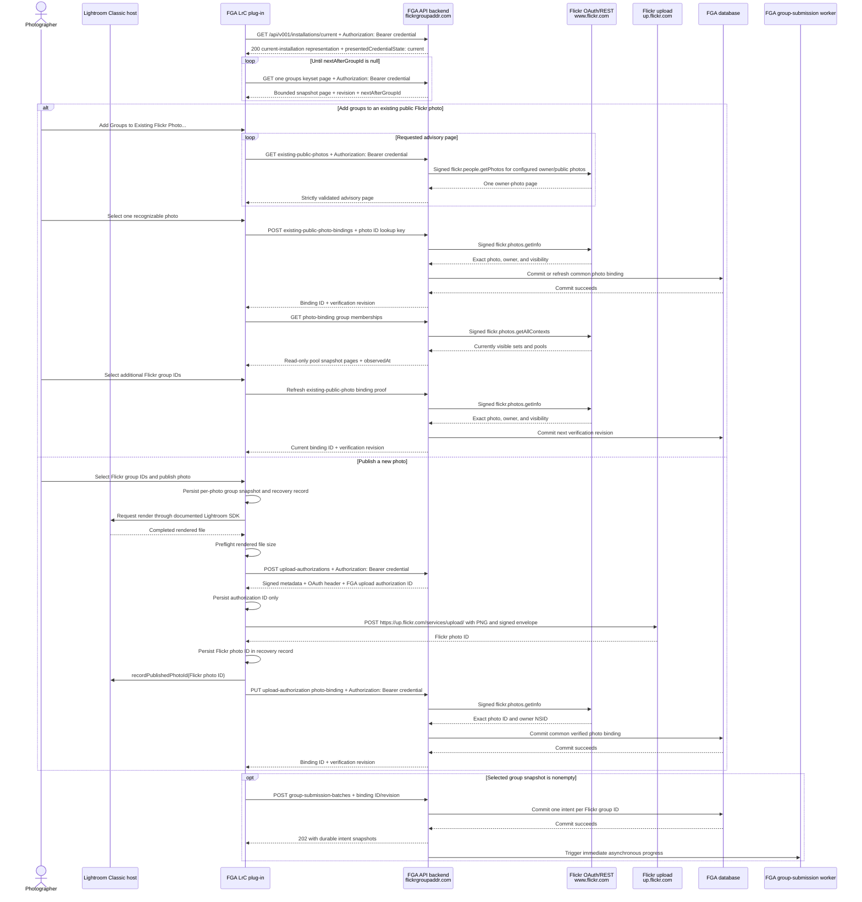

# Lightroom plug-in to hosted-service contract

Last updated: 2026-09-05

Status: Accepted private-MVP semantics; explicitly unresolved wire shapes are
not yet executable OpenAPI

Authority: Accepted normative contract. Accepted ADRs govern consequential
choices; this file owns its scoped hosted wire detail. See the
[documentation authority hierarchy](README.md).

## Purpose

This document defines the smallest complete interaction between the FGA LrC
plug-in and FGA API backend. It begins with the plug-in validating its stored
installation credential, continues through obtaining the Flickr groups
available to the authenticated user, and ends when the API backend has durably
accepted one group-submission intent for each selected Flickr group, when any
were selected. ADR 0010 permits publication with no group additions. The
ADR 0011 defines one explicit hosted photo-binding and ownership-proof
resource for both zero-group and nonempty-group publication. FGA localswim
ticket #0020 records review of that contract. ADR 0012 defines the
photographer-driven exception when the upload response did not provide a
Flickr photo ID; FGA localswim ticket #0021 records its acceptance.

The client wire contract deliberately stops at the durable boundary. Internal
worker leases, due scheduling, dispatch recovery, and database constraints are
defined by
[`worker-persistence-scheduler-contract.md`](worker-persistence-scheduler-contract.md);
Flickr result classification remains in the accepted Phase 7 and fail-polite
contracts.

ADR 0008 also requires group-intent submission for existing public photos in
the configured owner's Flickr account, regardless of uploader or Lightroom
Classic catalog binding. ADR 0021 and the
[existing-public-photo intake contract](existing-public-photo-intake.md) define
owner-scoped discovery, in-Lightroom Classic selection, fresh owner/public
proof, common photo-binding identity, and the binding-scoped group handoff.
Ticket #0053 may refine the selector presentation without weakening that
authority boundary.

## Preconditions

For the private single-user MVP:

- The FGA administrative control plane has been provisioned with the owner's
  Flickr application credentials and OAuth token.
- The FGA administrative control plane authenticates Terry through direct
  Google Identity Services, current Google ID-token validation, an exact
  allowlisted Google `sub`, and accepted ADR 0043's transaction-bound recent
  Google reauthentication in the
  [`browser-session lifecycle`](browser-session-lifecycle.md);
  it never accepts an FGA installation credential as administrator proof.
- The FGA API backend has generated an opaque, revocable FGA installation
  credential from exactly 32 cryptographically random octets and encoded it in
  ADR 0044's canonical grouped Crockford Base32 form. The API backend stores
  the complete 64-character credential's unsalted SHA2-256 digest and active
  state, not its plaintext. The credential carries no appended HMAC tag or
  claims.
- The FGA LrC plug-in displays the FGA User UI Plugin Code URL and a transient
  Plugin Code input. The user obtains the one-time-displayed
  credential through the same-workstation private-window ceremony, pastes it
  directly from the local nonhistorical/nonsynchronized clipboard into the
  field, compares the simultaneous clear-text browser and plug-in renderings,
  and the plug-in stores it with `LrPasswords`. The
  [transfer contract](private-install-credential-transfer.md) defines the exact
  cleanup and failure handling.
- Every plug-in request uses HTTPS and authenticates with that installation
  credential in `Authorization: Bearer <FGA installation credential>`. The
  Lightroom SDK provides no documented TLS-version contract or selector, so
  the negotiated version is not part of the plug-in API contract.
  The preferred FGA-edge minimum is TLS 1.3-or-newer, subject to a real probe
  using the latest Creative Cloud LrC release on the owner's adopted latest
  production/stable Windows release and the independent deployment gate in
  [`operations/tls-edge-acceptance.md`](operations/tls-edge-acceptance.md).
- The FGA LrC plug-in generates no credential, nonce, correlation ID, or
  idempotency value. Security-sensitive random values come from the FGA API
  backend runtime or operating system.
- The plug-in does not launch, control, exchange data with, or receive a
  callback from a browser. The user may manually open the displayed
  administrative URL in a browser on any trusted device.

The full cold-start interaction is documented in
[`zero-state-publish-flow.md`](zero-state-publish-flow.md), ADR 0006, and the
[authoritative clean-room interaction maps](decisions/0041-use-clean-room-authentication-tabs-as-interaction-authority.md).
The
[Future Terry FAQ](future-terry-faq.md) explains the bootstrap terminology and
ordering. A future public or self-service browser/device pairing flow is a
separate contract and does not block the private-MVP publish flow.

"Provision an installation" means create a server-side installation identity
and its revocable credential. It does not mean register, customize, or approve
a particular copy of the plug-in binary. Download and installation may happen
before or after administrative provisioning, but successful activation cannot
happen until the plug-in receives the credential.

The administrative browser authorizes the FGA OAuth handler to call Flickr as
the linked owner. The FGA LrC plug-in does not initiate that browser flow and
never receives the resulting Flickr consumer secret, access-token secret, or
other long-lived Flickr signing material. Manual pre-provisioning deliberately
replaces both smart-TV-style device-code polling and a host-browser callback
flow for the private MVP.

## Credential transport

Every authenticated plug-in request carries exactly one `Authorization`
header:

```http
Authorization: Bearer <FGA installation credential>
```

The credential never appears in a URL, query parameter, or JSON body. Under
[ADR 0044](decisions/0044-use-canonical-crockford-base32-plugin-codes.md), its
canonical wire value contains 52 uppercase Crockford Base32 symbols in 13
four-symbol groups separated by 12 ASCII hyphens. It matches only
`^[0-9A-HJKMNP-TV-Z]{4}(?:-[0-9A-HJKMNP-TV-Z]{4}){11}-[0-9A-HJKMNP-TV-Z]{3}[0G]$`.
The FGA LrC plug-in and FGA API backend reject lowercase, aliases, whitespace,
missing or moved hyphens, and every other noncanonical spelling without
normalization. All 64 characters, including hyphens, are the bearer credential
and SHA2-256 input.

That spelling satisfies RFC 6750's `b64token` grammar, so the plug-in can
concatenate the fixed `Bearer ` prefix without quoting or another encoding
pass. The credential remains FGA's opaque installation bearer token; it is not
a JWT, a Flickr OAuth token, or a claim that FGA implements an OAuth 2.0
issuance flow.

The Lightroom Classic 15.3 SDK documents `LrHttp.get(url, headers, timeout)` and
represents each supplied header as a table with `field` and `value` entries. Its
own `LrHttp` example uses an `Authorization` field. The plug-in therefore calls
authenticated GET operations with the equivalent of:

```lua
local headers = {
    { field = "Authorization", value = "Bearer " .. credential },
}
local responseBody, responseHeaders = LrHttp.get(url, headers)
```

The plug-in must never log the `headers` table or credential. FGA's edge,
application logs, tracing, exception capture, and correlation tooling must
redact `Authorization` before recording request metadata.

The SDK documents returned `Set-Cookie` headers and `LrHttp.parseCookie`, but it
does not document a persistent browser-style cookie jar, automatic cookie
replay contract, or `HttpOnly` isolation guarantee. `HttpOnly` protects a
browser-managed cookie from non-HTTP script APIs. A Lua plug-in that must read,
store, and manually resend a cookie gains no such protection and adds ambient
cookie state. The FGA API backend therefore does not authenticate the plug-in
with cookies.

### Standards and best-practice map

This is a standard bearer-authentication use, not an FGA-special header:

| Authoritative source | Relevant rule or guidance | FGA disposition |
| --- | --- | --- |
| Adobe Lightroom Classic 15.3 SDK, `API Reference/modules/LrHttp.html` | `LrHttp.get` accepts caller-supplied `field`/`value` headers; Adobe's example uses `Authorization` | Followed directly by the Lua header table above; this licensed primary source is restored locally as documented in [`vendor/LrC SDK/README.md`](../vendor/LrC%20SDK/README.md) |
| [RFC 9110 §11.6.2](https://www.rfc-editor.org/rfc/rfc9110.html#section-11.6.2) | `Authorization` is the HTTP field for credentials used to authenticate a user agent to an origin server | Followed; the FGA API backend does not invent a credential header |
| [RFC 6750 §§1 and 2.1](https://www.rfc-editor.org/rfc/rfc6750.html#section-2.1) | Defines `Authorization: Bearer <b64token>`, recommends that clients use it, requires resource-server support, and explicitly permits bearer tokens from any source—not only an OAuth issuance flow | Followed for header name, scheme, separator, and token grammar |
| [RFC 6750 §5.3](https://www.rfc-editor.org/rfc/rfc6750.html#section-5.3) | Safeguard bearer tokens, validate the TLS peer, always use HTTPS, avoid URL transport, scope tokens, prefer short lifetimes, and protect any cookie use from cleartext and CSRF | The FGA HTTPS edge and API backend require HTTPS, never put the credential in a URL, restrict it to the API and installation's authorized operations, redact it, and record the private-MVP lifetime exception below |
| [RFC 9205 §§4.10 and 4.12](https://www.rfc-editor.org/rfc/rfc9205.html#section-4.12) | HTTP APIs can use the HTTP authentication framework; cookie state is ambient authority that must be scoped carefully | The FGA API backend uses HTTP authentication and avoids adding cookie state to this non-browser client |
| [RFC 10025 §4.1.2.6](https://doi.org/10.17487/RFC10025) | `HttpOnly` tells a conforming user agent to omit a cookie from non-HTTP APIs | Not usable as a documented Lightroom boundary: Adobe exposes cookie text to Lua but promises no conforming persistent cookie store or `HttpOnly` enforcement |
| [RFC 9700 §§2.2.1 and 2.3](https://www.rfc-editor.org/rfc/rfc9700.html#section-2.2.1) | Prefer sender-constrained bearer tokens and least privilege/audience restriction to reduce replay damage | The FGA API backend applies least privilege and one-origin audience in server authorization; the accepted sender-constraint limitation is recorded below |
| [OWASP Authorization Cheat Sheet](https://cheatsheetseries.owasp.org/cheatsheets/Authorization_Cheat_Sheet.html) | Deny by default, validate permission on every request, fail safely, and test authorization logic | The FGA API backend uses an exhaustive stored-credential-class/route matrix with a rejecting default and regression tests for unknown and version-skewed classes |
| [OWASP REST Security Cheat Sheet: Sensitive information in HTTP requests](https://cheatsheetseries.owasp.org/cheatsheets/REST_Security_Cheat_Sheet.html#sensitive-information-in-http-requests) | Secrets must not appear in URLs; sensitive GET data belongs in a request header | Followed; the current-installation read has no query parameters, and the credential is header-only |
| [OpenAPI 3.2.0 §4.27](https://spec.openapis.org/oas/v3.2.0.html#security-scheme-object) | Models standard HTTP bearer authentication as `type: http` and `scheme: bearer` | The future OpenAPI description will use those values and omit `bearerFormat` because the credential is opaque, not JWT |

Two private-MVP limitations remain explicit. First, this manually provisioned
installation credential is long-lived instead of being a short-lived access
token backed by a refresh protocol. The
[installation credential lifecycle](installation-credential-lifecycle.md)
requires planned annual rotation and incident-driven revocation but deliberately
does not impose an automatic expiry that could strand an offline workstation.
Second, it is not
sender-constrained: the current documented Lightroom SDK exposes neither a
client-certificate facility nor the asymmetric signing and protected-key
facilities needed for mTLS- or DPoP-style proof of possession. `LrPasswords`,
HTTPS, one-time display, narrow server authorization, nonlogging, and
revocation mitigate—but do not erase—the bearer-secret extraction risk. The
annual documented-SDK review must revisit both limitations when Adobe adds
relevant supported APIs. An `HttpOnly` cookie would solve neither limitation.

The FGA API backend also follows RFC 6750's Bearer error categories. A request without
authentication receives `401 Unauthorized` and
`WWW-Authenticate: Bearer realm="fga-api"` without an error attribute. A
present but invalid token receives `401 Unauthorized` and the same challenge
with `error="invalid_token"`. The FGA API backend reserves `403 Forbidden` for
an authenticated credential that lacks permission, using
`error="insufficient_scope"` when that Bearer category accurately describes the
failure.

## Credential class and fail-closed authorization

Every installation record has a non-null stored `credential_class`. The private
MVP recognizes exactly `lrc_plugin`. That version-neutral internal class is
assigned by the FGA API backend, not selected by a request. It authorizes only the explicitly listed plug-in API
routes and resources belonging to its installation/FGA user. It never
authorizes `/admin/`, `/api/v001/admin/`, another user's resources, or an
arbitrary future route.

The initial `lrc_plugin` method/path allowlist is exhaustive:

| Method | Path template |
| --- | --- |
| `GET` | `/api/v001/installations/current` |
| `GET` | `/api/v001/groups` |
| `GET` | `/api/v001/existing-public-photos` |
| `POST` | `/api/v001/existing-public-photo-bindings` |
| `GET` | `/api/v001/photo-bindings/{photoBindingId}/group-memberships` |
| `POST` | `/api/v001/upload-authorizations` |
| `PUT` | `/api/v001/upload-authorizations/{uploadAuthorizationId}/photo-binding` |
| `GET` | `/api/v001/upload-authorizations/{uploadAuthorizationId}/ambiguity-candidates` |
| `PUT` | `/api/v001/upload-authorizations/{uploadAuthorizationId}/ambiguity-resolution` |
| `POST` | `/api/v001/group-submission-batches` |
| `GET` | `/api/v001/group-submission-intents` |
| `GET` | `/api/v001/group-submission-intents/{submissionIntentId}` |

Each template still applies its resource-owner, state, and schema rules. The two
status routes are read-only and follow the
[group-submission status contract](queue-status-api.md). Any later operation
must extend this table deliberately before a credential can reach it; omission
denies.

Credential-version state narrows this class allowlist:

| Credential-version state | Effective authority |
| --- | --- |
| `current` on an active installation | The complete `lrc_plugin` allowlist above |
| Unexpired `pending_rotation` | Only `GET /api/v001/installations/current`, returning `presentedCredentialState: "pending_rotation"`; every other listed route is `403 insufficient_scope` |
| `replaced`, `revoked`, `expired_unactivated`, unknown, or inconsistent | No authenticated authority; nonspecific `401 invalid_token` |

The database allows at most one current plus one pending version per active
installation. The pending exception is explicit and cannot fall through from a
generic truthy/active state.

The FGA HTTPS edge routes exact `/api/v001` and prefix `/api/v001/` to the FGA
API backend before any asset or application-shell fallback. The generated
[route conformance gate](operations/http-route-conformance.md) proves every
registered method/path is reachable through the real development topology and
provider preview; an unknown API path must reach the backend's non-HTML `404`.

The FGA API backend performs these checks independently on every request:

1. Parse exactly one supported authentication transport and validate the Bearer
   wire grammar.
2. Compute the SHA2-256 digest and load the candidate installation record.
3. Match the stored `credential_class` against an exhaustive application
   allowlist. Null, empty, differently cased, malformed, corrupt, retired, and
   syntactically valid but unrecognized values all take the explicit reject
   branch.
4. Treat the stored class as authoritative. No client-supplied header, JSON
   field, query parameter, or route parameter creates or overrides that class.
5. Authorize the exact known class against the exact route, method, resource
   owner, credential state, and operation-specific requirements.

There is no `else browser`, `else administrator`, closest-version, legacy, or
default-client mapping. Browser administration uses its independently validated
Google-authenticated opaque server-side cookie session and never enters the installation Bearer
dispatcher. An unknown stored class fails authentication as the same
non-oracular `401 invalid_token` used for other invalid credentials. A known,
successfully authenticated class that lacks authority for a route receives the
ordinary `403 insufficient_scope` result.

The FGA database also rejects an unrecognized `credential_class` on insert or
update, but that constraint is defense in depth rather than the dispatcher's
default. The runtime must still reject an unknown value produced by version
skew, restored data, corruption, a relaxed future constraint, or a test double.
It records only an opaque credential-record/correlation ID and sanitized
`unknown_credential_class` reason; it does not log the Bearer value, digest, or
raw unexpected class.

### Forward and rollback compatibility

A new credential class uses an expand/deploy/create sequence:

1. Add the new class and its exact route/method authority to code and tests;
   all unspecified routes still deny.
2. Deploy that reader/authorizer everywhere before expanding the database
   constraint and creating a row of the new class.
3. Create new-class credentials only after every serving deployment recognizes
   the class.

An older application binary that encounters the future value must return
`401 invalid_token`, not reinterpret it. Before rolling back to a release that
does not support an active class, the operator revokes or migrates those
credentials when continued service is required; an emergency rollback may
leave them unavailable but never more privileged. A database migration that an
older release cannot read at all blocks that rollback instead of invoking a
compatibility fallback.

The automated authentication suite must cover null/empty/case variants,
arbitrary and plausible future values, the database constraint, old-reader/new-
row forward skew, new-reader/old-row compatibility, rollback with a new-class
row, every route/method pair, and a mutation that changes the default rejection
to any recognized authority. Each unknown-class case must prove no plug-in,
browser, or administrative handler runs and no protected resource mutation
occurs.

## Identifiers

The contract uses explicit, qualified names:

- **Flickr photo ID:** returned by Flickr after a successful upload.
- **Flickr group ID:** returned by Flickr group discovery and selected by the
  photographer.
- **Lightroom photo UUID:** a non-secret identifier for one catalog record. It
  may correlate local recovery state but is not sent as user identity and is
  not a cross-catalog image identity.
- **FGA upload authorization ID:** generated by the FGA API backend when it
  signs one upload envelope; used for correlation, not as proof that Flickr
  accepted an upload.
- **FGA photo binding ID:** generated by the FGA API backend after fresh hosted
  proof; the common server identity for one FGA user/Flickr photo pair from
  either intake path.
- **FGA submission intent ID:** generated by the FGA API backend for one durable
  `(Flickr photo ID, Flickr group ID)` intent.

## Accepted local group-selection interaction

[ADR 0045](decisions/0045-use-a-library-modal-and-photo-metadata-for-group-selection.md)
maps the accepted per-photo behavior onto documented Lightroom SDK 15.3
interfaces. The FGA LrC plug-in registers **FlickrGroupAddr:
Choose Group Additions…** through `LrLibraryMenuItems`. The command accepts
exactly one selected photo while exactly one ordinary FGA Album is the active
source, verifies that membership through `LrCatalog`, and opens one native
`LrDialogs.presentModalDialog` built from documented `LrView` controls.

The selector keeps current Flickr memberships, prior intents, and permanent
blocks read-only under the moderator-safety UI conformance contract. An
unpublished photo has the explicit **No group additions** or **Add to selected
groups** choice. A bound photo can queue only first-time eligible additions and
proceeds to the existing batch handoff without another render or upload.

The accepted editable store is one private untitled `LrMetadataProvider` string
field named `groupAdditionSelections` on each `LrPhoto`. ADR 0045 owns its
versioned JSON shape and lifecycle. Every entry is scoped by the exact FGA
publish-service local ID, published-collection local ID, and persistent
Lightroom photo UUID, contains an explicit zero-or-groups choice and a local
selection revision, and holds at most 60 unique exact Flickr group IDs. The FGA
LrC plug-in replaces one entry inside a synchronous
`LrCatalog:withPrivateWriteAccessDo()` callback with no network or UI work in
the write gate. Malformed or unknown stored state fails closed and is never
silently treated as an empty selection.

The single-photo command never loops over a selection. A multi-photo publish
callback opens no modal: it independently consumes each already saved choice,
reports an absent choice as **No group additions were configured**, and lets
other photos continue if one stored record is invalid. Before rendering, the
FGA LrC plug-in copies a nonempty choice and its revision to the separately
durable recovery/outbox record. It clears a consumed editable entry only after
the hosted batch is durable and only when the stored revision still matches,
so an older callback cannot erase a later edit.

## Complete interaction

The sequence below is the successful path for one Lightroom rendition. A
publish batch repeats the render-through-applicable-handoff portion
independently for each photo and its snapshot of zero or more group selections.
The batch is eventually consistent, not atomic or ordered: one photo's failure
or ambiguous state does not stop a healthy photo merely to preserve Lightroom
Classic publish-run order, and no photo may disappear without a durable outcome.

Album creation and dispatch remain native Lightroom Classic publish-service
interactions. The FGA LrC plug-in labels user-created ordinary published
collections as **Album**, creates no default collection, exposes no smart
albums, uses documented remote ID/URL storage, and accepts Lightroom Classic's
standard selected-work or album-level publish callbacks as the initial
evidence-backed shape. Selecting a local Album selects its one hosted binding
and Flickr photoset; no ordinary path adopts an arbitrary remote album. Ticket
#0065 may replace or streamline user-visible interactions when a documented
Lightroom SDK design measurably improves Terry's loop without losing current
capability. The [album-scoped publish
contract](album-scoped-publish-contract.md) defines identity, first-photo
materialization, and per-photo obligations; the [album-write reconciliation
contract](album-write-reconciliation.md) defines ambiguous-create repair and
attachment evidence; and the [album lifecycle
contract](album-lifecycle-contract.md) defines rename, reparent, and
non-destructive local removal.



The FGA API backend never receives the rendered image. The FGA LrC plug-in
never receives the Flickr consumer secret or OAuth token secret.

The selected FGA API origin is `https://flickrgroupaddr.com`. All hosted
plug-in API endpoint paths begin with `/api/v001/`. API versions always use
exactly three zero-padded decimal digits; for example, the first version is
`v001`, not `v1`. The URI version is independent from the integer
`schemaVersion` carried by JSON documents.

Every collection operation whose cardinality the FGA API backend does not
independently bound uses pagination with a server-enforced maximum page size.
A synchronous FGA API request must not follow an uncontrolled number of
upstream pages before it can respond. Pagination bounds each request, not the
complete operation, so the FGA API backend also applies explicit page-count,
elapsed-time, storage, and abuse budgets to collection construction.

Plug-in API paths name FGA resources rather than the upstream integration. No
route is a transparent byte-for-byte proxy. The following mapping makes the
implementation relationship explicit without coupling it into the URI:

| FGA operation | Flickr operation | Relationship |
| --- | --- | --- |
| `GET https://flickrgroupaddr.com/api/v001/groups` | `GET https://www.flickr.com/services/rest/?method=flickr.groups.pools.getGroups` | Snapshot-backed read; one bounded FGA refresh worker job walks all Flickr pages into staging, then the FGA API backend atomically replaces and serves one revision through ordinary keyset pages |
| `GET https://flickrgroupaddr.com/api/v001/existing-public-photos` | `GET https://www.flickr.com/services/rest/?method=flickr.people.getPhotos` | Authenticated, owner-fixed, public-photo advisory paging; malformed or mixed pages fail closed rather than becoming a partial or empty list |
| `POST https://flickrgroupaddr.com/api/v001/existing-public-photo-bindings` | `GET https://www.flickr.com/services/rest/?method=flickr.photos.getInfo` | Safe proof operation; the client photo ID is only a lookup key and the FGA API backend verifies exact ID, configured owner, public visibility, and link revision before committing a common binding |
| `GET https://flickrgroupaddr.com/api/v001/photo-bindings/<FGA photo binding ID>/group-memberships` | `GET https://www.flickr.com/services/rest/?method=flickr.photos.getAllContexts` | Fresh binding-scoped read-through; the FGA API backend derives the photo and owner, validates the complete bounded Flickr response, retains pool entries, and serves one current observation revision through ordinary keyset pages |
| `POST https://flickrgroupaddr.com/api/v001/upload-authorizations` | `POST https://up.flickr.com/services/upload/` | Split authorization: the FGA API backend validates metadata and prepares the signed Flickr request; the FGA LrC plug-in adds the file and sends it directly to Flickr |
| `POST https://flickrgroupaddr.com/api/v001/group-submission-batches` | `POST https://www.flickr.com/services/rest/` with `method=flickr.groups.pools.add` | Not a synchronous passthrough; the FGA API backend durably accepts intents and FGA group-submission workers perform the Flickr calls later |
| `GET https://flickrgroupaddr.com/api/v001/group-submission-intents[...]` | No Flickr request | Read-only FGA database projection; status refresh never schedules or dispatches work |

Sanitized structured logs, metrics, and traces expose the internal boundary.
They identify the FGA operation, whether upstream dispatch began, the
allowlisted Flickr method, result class, duration, and internal correlation IDs;
they contain no credentials, OAuth fields, raw bodies, photo titles, group
names, or local catalog data. ADR 0031 records the route and
observability decision.

The credential-validation resource is
`GET /api/v001/installations/current`. ADR 0032 records the removal of
the unreleased device token-check route and speculative profile query.

## 1. Read the current installation

Provisional operation:

```text
GET https://flickrgroupaddr.com/api/v001/installations/current
```

The plug-in presents the stored installation credential as
`Authorization: Bearer <FGA installation credential>`, using the same
authentication mechanism as its other FGA API requests. The request has no body
or query parameters. This safe, idempotent read does not call Flickr, refresh a
Flickr token, retrieve groups, create a session, or return a replacement token.

A current credential for an active installation returns `200 OK`,
`Cache-Control: no-store`, and:

```json
{
  "schemaVersion": 1,
  "installationId": "server-generated-installation-id",
  "installationRevision": 7,
  "installationState": "active",
  "presentedCredentialState": "current"
}
```

An unexpired pending rotation candidate may read the same resource and receives
the same shape with `presentedCredentialState: "pending_rotation"`; it remains
insufficiently scoped for every ordinary plug-in route. The representation
contains no credential version ID, class, user or Flickr identity, secret,
digest, replacement token, or session. The FGA LrC plug-in exhaustively matches
the schema, expected locally retained installation ID after initial activation,
active installation state, and presented-credential state before it marks the
FGA connection authenticated or a rotation candidate verified.

Connection reuse is scoped to the same exact `(scheme, hostname, port)` origin.
It is permitted only after the preceding response is fully consumed and while
the owning HTTP stack retains the connection as open and eligible. When another
request is ready, a new connection is required if no matching connection is
pooled, either endpoint closed it, the server instructed the client to close it,
the preceding response was not fully consumed or had invalid or incomplete
framing, a TCP, TLS, or HTTP protocol error or timeout made it unusable, or the
stack retired it under a documented finite idle, lifetime, or request-count
policy. The FGA LrC plug-in leaves this decision to the Lightroom Classic host's
`LrHttp` implementation; hosted FGA components use their standard HTTP clients'
connection-pool decisions rather than an application-level liveness probe. DNS
TTL expiry alone does not invalidate an established connection. A newly opened
connection uses the applicable resolver and cache and performs a new TLS
handshake and validation for the requested origin.

Every later FGA API request still presents and independently authenticates the
installation credential. The internal server-assigned credential class is
`lrc_plugin`; it is not supplied by the request or returned in this
representation. A future concrete second profile may add explicit capability
representation or negotiation without renaming the current-installation
resource.

A request with no authentication information returns `401 Unauthorized` with a
bare Bearer challenge and no error attribute. Repeated authorization fields,
multiple token-transmission methods, a request body, any query parameter, or
another malformed request envelope produces `400 Bad Request` with
`invalid_request`. A malformed token value or a credential that is unknown,
inactive, expired, replaced, revoked, disabled, has an unknown stored class, or
fails any integrity, signature, or other verification check returns the same
nonspecific `401 Unauthorized` with `invalid_token`. The resource does not
return `403` merely because an invalid token was parseable.

### Rotation and revocation

The FGA LrC plug-in stores a planned replacement under a second fixed
`LrPasswords` candidate key and blocks its own new ordinary API work while
rotation completes. A 15-minute `pending_rotation` credential authenticates
only to the current-installation resource:

```text
GET https://flickrgroupaddr.com/api/v001/installations/current
Authorization: Bearer <pending rotation credential>
```

The `200` representation identifies the active installation and exact
`pending_rotation` presented-credential state. The candidate receives `403
insufficient_scope` on all ordinary plug-in routes. Terry reviews the plug-in's
verified state and uses the recent-authenticated administrative completion POST
to atomically promote the candidate and replace the prior current version. The
plug-in repeats the current-installation read until
`presentedCredentialState` is `current`, then stores/retrieves the new current
key before clearing the candidate key with documented
`LrPasswords.store("")`. A lost response or crash resumes by reading candidate
and administrative state; it never resumes the locally retained old credential
while the candidate key is nonempty.

Administrative revocation invalidates current and pending versions together.
Every state-changing FGA API backend transaction rechecks the exact credential
version and installation revision. The complete issuance, annual/incident
rotation completion, cancellation/expiry, lost-workstation, local clearing,
audit, and
failure contract is in
[`installation-credential-lifecycle.md`](installation-credential-lifecycle.md).

## 2. Discover writable Flickr groups

Provisional operation:

```text
GET https://flickrgroupaddr.com/api/v001/groups?page_size=100
```

`page_size` is required and must be a single decimal integer from 1 through
100. The initial request omits `snapshot_revision` and `after_group_id`. The
FGA API backend serves one complete current snapshot and orders rows by the
bytewise UTF-8 representation of exact Flickr group ID.

A snapshot at most 15 minutes old is `fresh`. If it is older, the FGA API
backend creates or joins one refresh job and continues serving the last good
snapshot as `stale_refreshing` or `stale_refresh_failed`. If no successful
snapshot exists, an active refresh produces `202 Accepted` with `Retry-After`
and a failed refresh produces `503 Service Unavailable` with
`group_refresh_unavailable`; neither response contains a group array.

One FGA refresh worker job follows every Flickr page from page 1 under fixed
limits of 25 pages, 10,000 distinct rows, 2 MiB per response, and 60 seconds of
monotonic elapsed time. It independently signs and validates each page and
writes only reduced rows to staging. It creates no per-page work items. One FGA
database transaction replaces the visible rows, advances `snapshotRevision`,
and records `refreshedAt` only after the final complete page. Any failure or
limit violation leaves the prior snapshot unchanged and is never represented
as an empty successful refresh.

The successful response is `200 OK`:

```json
{
  "schemaVersion": 1,
  "snapshotRevision": 42,
  "refreshedAt": "2026-08-26T20:00:00Z",
  "snapshotStatus": "fresh",
  "groups": [
    {
      "flickrGroupId": "example-group-id",
      "displayName": "Example Group"
    }
  ],
  "nextAfterGroupId": "example-group-id"
}
```

When another row exists, `nextAfterGroupId` is the last returned Flickr group
ID. The continuation repeats `page_size` and supplies both revision and keyset
boundary:

```text
GET https://flickrgroupaddr.com/api/v001/groups?page_size=100&snapshot_revision=42&after_group_id=<last Flickr group ID>
```

The FGA API backend requires both continuation parameters together, requires the
revision still be current, and selects IDs strictly greater than
`after_group_id`. A changed revision returns `409 Conflict` with
`snapshot_changed` and no groups. The FGA LrC plug-in discards the incomplete
aggregate and restarts once at the initial request. Otherwise it follows pages
until `nextAfterGroupId` is null, may sort the completed aggregate by display
name, and retains Flickr group IDs as identity. The UI must show stale status
and times; `stale_refresh_failed` includes `refreshFailedAt`. A later
eligibility change remains authoritative at Flickr.

No request creates a random continuation record or pins an immutable snapshot
generation. The [group snapshot and pagination
contract](group-snapshot-and-pagination.md) defines the job admission, state,
limits, keyset behavior, and conformance evidence. ADR 0030 records the
simplification.

## 3. Discover and bind an existing public Flickr photo

The FGA LrC plug-in opens **Add Groups to Existing Flickr Photo…** with:

```text
GET https://flickrgroupaddr.com/api/v001/existing-public-photos?page=1&page_size=100
```

The FGA API backend fixes the current linked owner NSID, public privacy filter,
and photo content type, then pages authenticated
`flickr.people.getPhotos`. It returns only a completely validated advisory page
of bounded title/date/public-thumbnail fields. A malformed or failed page is
`existing_photo_discovery_unavailable`, never a partial or empty photostream.

After one row is selected, and again immediately before a group batch that may
create work, the FGA LrC plug-in sends:

```text
POST https://flickrgroupaddr.com/api/v001/existing-public-photo-bindings
```

The JSON contains the selected opaque Flickr photo ID and the expected linked-
Flickr revision. The ID is only a lookup key. The FGA API backend performs a
fresh strict `flickr.photos.getInfo`, requires the exact photo ID, configured
owner NSID, and public visibility, then creates or refreshes one common server
photo binding. Wrong-owner, private, missing, malformed, unavailable, or link-
race results create no verified revision.

The response returns `fgaPhotoBindingId`, `verificationRevision`, and
`verifiedAt`. An upload-origin binding for the same FGA user/photo is reused;
provenance is retained as an event rather than a second identity. The exact
response, error, pagination, UI, persistence, and conformance rules are in the
[existing-public-photo intake contract](existing-public-photo-intake.md) and
[ADR 0021](decisions/0021-fresh-server-proof-for-existing-public-photos.md).

## 3.5. Read current Flickr group membership for a verified photo binding

Provisional operation:

```text
GET https://flickrgroupaddr.com/api/v001/photo-bindings/<FGA photo binding ID>/group-memberships?page_size=100
```

`page_size` is required and follows the same 1-through-100 validation as group
discovery. An initial request omits `observation_revision` and
`after_group_id`. A continuation repeats the same path and `page_size` and
supplies the preceding page's `observationRevision` and `nextAfterGroupId`.

The FGA LrC plug-in makes a new initial request every time it opens group
selection for a verified photo from either intake path. It supplies the FGA
installation credential as `Authorization: Bearer <FGA installation
credential>`. The FGA API backend authenticates the installation, loads the
path binding, and derives the exact Flickr photo ID and FGA user from it. An
absent or differently owned binding returns a nonspecific `404 Not Found` and
causes no Flickr request. The client never supplies a substitute photo ID.

For an authorized initial request, the FGA API backend resolves the
authenticated user's linked Flickr OAuth 1.0a access token and token secret,
generates a fresh OAuth nonce and timestamp, and signs this exact Flickr read:

```text
GET https://www.flickr.com/services/rest/?method=flickr.photos.getAllContexts&photo_id=<Flickr photo ID>&format=json&nojsoncallback=1
```

The FGA API backend never answers an initial request from FGA intent history or
a prior membership cache. Flickr is authoritative because its UI, other API
clients, and group moderators can change pool membership without involving the
FGA API backend or FGA database.

Flickr returns visible photoset and pool contexts in one response and exposes
no upstream pagination arguments for this method. The FGA API backend enforces
fixed limits of 2 MiB, 10,000 combined set/pool context entries, and 15 seconds
of monotonic elapsed time on that single response. A limit violation, malformed
response, or incomplete read fails explicitly and publishes no partial
observation. The FGA API backend discards photoset entries, retains only pool
IDs and names, and atomically replaces one current paging row set with a new
`observationRevision` and `observedAt` after the complete response is parsed.

### Complete upstream shape or unknown

Flickr's official JSON response contract places a `stat` member on the root and
represents repeated REST elements as arrays. The FGA API backend accepts a
membership observation only when all of these conditions hold:

- the HTTP response completes within its limits and has an allowlisted JSON
  media type and character encoding established by the compatibility suite;
- the complete body parses as one JSON object with exact `stat: "ok"`;
- the root contains `pool` as an array, including an explicit empty array when
  no pool membership is observed;
- every pool element is an object with one nonempty, syntactically valid Flickr
  group ID and a bounded string title in the documented members;
- no pool entry is null, scalar, nested array, missing an ID/title, duplicated
  by group ID, or over a field/collection budget; and
- every known repeated collection that is present, including discarded `set`
  contexts, has its documented array container shape.

Unknown additional root/object members may be ignored after budgets are
enforced; they do not justify coercing a known member. In particular, a
missing, null, object, string, number, or boolean `pool` is not an empty array.
The parser never uses `pool ?? []`, “array or empty,” truthiness, filtering, or
per-entry salvage. One malformed pool element invalidates the entire
observation rather than silently producing a smaller list.

Only the fully validated `pool: []` representation publishes a successful
empty snapshot. If production compatibility evidence shows that Flickr's
documented endpoint uses another unambiguous encoding for zero pool elements,
the contract and fixtures must be reviewed and changed deliberately before
that encoding is accepted; code must not infer it ad hoc.

A structurally complete `stat: "fail"` response follows the documented Flickr
application-code mapping; it never publishes an empty snapshot. Any transport,
HTTP, media-type, JSON, missing/unknown `stat`, successful-response shape,
field, duplicate, budget, or truncation failure produces `503 Service
Unavailable` with stable code `membership_observation_unavailable`,
`retryable: true`, `Retry-After`, and no `groups`, `observedAt`, or keyset state.
The failure records only a sanitized reason class and correlation ID. It
creates no membership observation and does not overwrite a previous successful
observation.

The FGA LrC plug-in treats that response—or a failure on any snapshot
continuation page—as one unavailable observation. It discards the incomplete
aggregate, labels membership **Unavailable**, and disables group-addition
confirmation for that already-published photo until a new initial read
succeeds. It never presents the prior snapshot or received prefix as current.

Primary upstream references are Flickr's
[`flickr.photos.getAllContexts`](https://www.flickr.com/services/api/flickr.photos.getAllContexts.htm)
method and [JSON response format](https://www.flickr.com/services/api/response.json.html).

The successful response is `200 OK`:

```json
{
  "schemaVersion": 1,
  "fgaPhotoBindingId": "server-generated-binding-id",
  "flickrPhotoId": "example-flickr-photo-id",
  "observationRevision": 17,
  "observedAt": "2026-08-22T16:00:00Z",
  "groups": [
    {
      "flickrGroupId": "example-current-group-id",
      "displayName": "Example Current Group"
    }
  ],
  "nextAfterGroupId": null
}
```

`groups` contains at most `page_size` pool entries ordered by the bytewise UTF-8
representation of exact Flickr group ID. When another row exists,
`nextAfterGroupId` is the last returned ID. A continuation sends
`observation_revision` and `after_group_id`; the FGA API
backend requires both together and requires the revision to remain current.
Every page repeats the same `fgaPhotoBindingId`, `flickrPhotoId`,
`observationRevision`, and `observedAt`. A concurrent new observation returns
`409 Conflict` with `membership_observation_changed`; the FGA LrC plug-in
discards the prefix and starts one new initial read. A successfully observed
empty pool list is valid; a failed read is never represented as that empty list.

The membership route creates no random cursor record and retains no immutable
generation. The [group snapshot and pagination
contract](group-snapshot-and-pagination.md) defines the shared keyset behavior
and membership-specific freshness rule.

The UI labels these entries **Currently in Flickr groups** and keeps them
read-only. It separately shows groups selected to add. The observation can
become stale immediately and is not a write precondition: a later external add
is handled idempotently by Flickr's “photo already in pool” status (code `3`),
while absence never clears an existing FGA intent or permanent block. The FGA
API backend exposes no operation mapped to `flickr.groups.pools.remove`, and
deselection in the FGA LrC plug-in has no removal meaning.

Before that selector enables confirmation, the FGA LrC plug-in also retrieves
every page of the retained `history` status view filtered by the exact binding.
It merges the writable-group snapshot, the fresh complete membership
observation, and server-projected intent/block history under the total rule in
the [moderator-safety UI conformance
contract](moderator-safety-ui-conformance.md). A failed or incomplete input
disables the complete handoff. Any existing intent removes the ordinary
first-add checkbox for that pair, and a non-null `permanentSubmissionBlock`
shows reviewed permanent-protection copy with no retry, acknowledged
resubmission, override, or block-clear action. Current non-membership and a
changed moderation setting do not weaken that projection.

## 4. Obtain a direct-upload authorization

Provisional operation:

```text
POST https://flickrgroupaddr.com/api/v001/upload-authorizations
```

Before making this request, the FGA LrC plug-in has received the Lightroom
Classic rendering engine's completed file and successfully preflighted it
against the configured format and Flickr size policy. This ordering lets the
plug-in use the signed envelope immediately rather than consuming its useful
timestamp window while the rendering engine produces a large image.

The request supplies the allowlisted, non-file Flickr upload metadata that the
FGA LrC plug-in intends to send. The MVP allowlist uses Flickr's exact field
names and string values:

- optional `title`, `description`, and `tags` strings;
- required `is_public`, `is_friend`, and `is_family` values, each either `"0"`
  or `"1"`;
- required `safety_level` value `"1"`, `"2"`, or `"3"`;
- required `content_type` value `"1"`, `"2"`, or `"3"`; and
- required `hidden` value `"1"` or `"2"`.

Requiring the visibility, safety, content-type, and search fields makes the
result independent of mutable Flickr account defaults. The FGA API backend
rejects client-supplied `photo`, `api_key`, OAuth fields, unknown field names,
and invalid field combinations. It injects `api_key` and the OAuth material.

```json
{
  "schemaVersion": 1,
  "flickrMetadata": {
    "title": "Example title",
    "description": "Example description",
    "is_public": "1",
    "is_friend": "0",
    "is_family": "0",
    "safety_level": "1",
    "content_type": "1",
    "hidden": "1"
  }
}
```

The successful response is `200 OK` and contains the exact fields covered by
the OAuth signature. The FGA LrC plug-in sends those values unchanged through
`LrHttp.postMultipart` and adds only the `photo` multipart part.

```json
{
  "schemaVersion": 1,
  "fgaUploadAuthorizationId": "server-generated-id",
  "issuedAt": "2026-08-20T20:00:01Z",
  "uploadUrl": "https://up.flickr.com/services/upload/",
  "authorizationHeader": "OAuth redacted-example",
  "flickrMetadata": {
    "api_key": "redacted-example",
    "title": "Example title",
    "description": "Example description",
    "is_public": "1",
    "is_friend": "0",
    "is_family": "0",
    "safety_level": "1",
    "content_type": "1",
    "hidden": "1"
  }
}
```

This response is sensitive bearer material even though it contains neither
Flickr secret. Both sides must apply `Cache-Control: no-store`, exclude the
response from logs and traces, keep it only in memory, and use it immediately.
The FGA API backend must not claim a hard expiry shorter than Flickr actually
enforces. If the FGA LrC plug-in loses the response before uploading, it
requests a fresh envelope.

Before responding, the FGA API backend durably creates an FGA database record
keyed by the FGA upload authorization ID. The record contains the authenticated
installation, FGA user, issue time, and a nullable Flickr photo ID field
initialized to null. It does not persist the title, description, tags, signed
metadata, upload URL, or OAuth authorization header.

## 5. Upload directly to Flickr

Using the already-rendered and preflighted file, the FGA LrC plug-in calls the
Lightroom SDK's documented `LrHttp.postMultipart` API to send a multipart
request directly to the returned Flickr upload URL. The plug-in copies every
returned metadata field exactly. The rendered file is the `photo` part and is
not covered by Flickr's OAuth signature.

Before requesting the authorization, the FGA LrC plug-in creates a durable
local recovery record containing the Lightroom photo UUID and the snapshotted
Flickr group IDs. When the FGA API backend issues an authorization, the plug-in
adds only the FGA upload authorization ID to that record. It never persists the
upload URL, OAuth authorization header, or signed metadata envelope.

Flickr's successful response supplies the Flickr photo ID. The FGA LrC plug-in
records that ID durably in the local recovery record before calling the
documented Lightroom SDK's `recordPublishedPhotoId`; the Lightroom Classic
catalog then holds it as the published photo's remote ID. The resulting pending
handoff/outbox record contains:

- FGA upload authorization ID;
- Flickr photo ID; and
- the selected Flickr group IDs.

The local record is written before attempting the hosted handoff and is marked
complete only after every applicable hosted obligation is durably acknowledged.
The FGA LrC plug-in retains the non-secret FGA upload authorization ID and
Flickr photo ID with its published-photo correlation so a later **Add more
groups** action can
hand off new group IDs without rendering or uploading the image again. A failed
hosted request never causes the plug-in to upload the image again.

A definitive Flickr rejection may be followed by a deliberate new attempt with
a fresh upload authorization. Once the FGA LrC plug-in invokes
`LrHttp.postMultipart`, a timeout, connection loss, or other missing definitive
Flickr result is not generic retry permission. The documented Lightroom SDK
contract supplies no proof that zero request bytes left the Lightroom Classic
host networking stack. The FGA LrC plug-in therefore **MUST NOT** replay that
image POST: Flickr may already have created the photo. It retains the local
record in `upload_outcome_unknown` and exposes **Upload outcome unknown — action
required**. No group-submission handoff, album creation or attachment, or
Lightroom Classic catalog remote-ID write occurs until the photographer either
reconciles one Flickr photo or deliberately authorizes a new copy under
ADR 0012.

A failure proven before `LrHttp.postMultipart` is invoked cannot have delivered
image bytes. The FGA LrC plug-in may discard the unused in-memory envelope,
obtain a fresh upload authorization, and start a new Flickr request. It never
reuses the earlier signed envelope and never calls an ambiguous post-dispatch
action a retry.

There is no atomic transaction spanning Flickr, the Lightroom catalog, and the
FGA API backend or database. Recovery from a process failure between Flickr
accepting the upload and the FGA LrC plug-in persisting the returned Flickr
photo ID remains a publish-provider lifecycle concern, not something this HTTP
contract can pretend to solve.

## 5.5. Durably bind and verify the uploaded photo

ADR 0011 defines an explicit operation independent of group work:

```text
PUT https://flickrgroupaddr.com/api/v001/upload-authorizations/
    <FGA upload authorization ID>/photo-binding
```

The JSON request contains `schemaVersion: 1` and the Flickr photo ID returned by
the upload. The FGA API backend authenticates the installation, requires that
it owns the path's upload authorization, calls documented
`flickr.photos.getInfo`, verifies the exact photo ID and linked owner NSID, and
conditionally commits the binding plus the successful observation. The first
commit returns `201 Created`; a repeated matching request returns `200 OK`; a
different photo ID for the same authorization returns `409 Conflict`.

Both successful responses contain the common server identity used by every
later binding-scoped read and group handoff:

```json
{
  "schemaVersion": 1,
  "fgaPhotoBindingId": "server-generated-binding-id",
  "sourceKind": "fga_direct_upload",
  "flickrPhotoId": "example-flickr-photo-id",
  "linkedFlickrRevision": 7,
  "verificationRevision": 1,
  "verifiedAt": "2026-08-26T12:45:00.123456Z"
}
```

The binding is unique to `(FGA user, Flickr photo ID)`. A later verified
existing-public-photo intake for the same pair reuses it and appends provenance
rather than creating a second identity.

On this normal path, the Lightroom Classic catalog remote ID means that Flickr
returned that upload result; it does not by itself mean the hosted proof
succeeded. Until the FGA LrC plug-in receives the committed binding
representation, its durable local record remains `uploaded_proof_pending`.
Timeouts and dependency failures may retry the same idempotent `PUT` with the
same upload authorization ID and Flickr photo ID, never the upload. Definitive
conflicts, owner mismatches, and exhausted retry budgets become
`uploaded_proof_needs_attention` without clearing the catalog remote ID.

## 5.6. Reconcile an ambiguous upload

ADR 0012 defines a separate path when the FGA LrC plug-in never
received a definitive Flickr photo ID. The plug-in may retrieve advisory owner-
photo candidates:

```text
GET https://flickrgroupaddr.com/api/v001/upload-authorizations/
    <FGA upload authorization ID>/ambiguity-candidates
```

The FGA API backend authenticates the installation, requires that it owns the
authorization, and queries documented Flickr owner-photo results beginning
slightly before the authorization's server-recorded issue time. It returns
only the Flickr photo ID, title, upload time, thumbnail URL, and photopage URL
needed for a photographer to distinguish candidates. Results are private,
`no-store`, advisory, and paginated. An empty or failed query never proves that
the upload failed.

The FGA LrC plug-in shows those fields and requires an explicit **Use this
Flickr photo** confirmation. It stores the selected ID locally before calling:

```text
PUT https://flickrgroupaddr.com/api/v001/upload-authorizations/
    <FGA upload authorization ID>/ambiguity-resolution
```

```json
{
  "schemaVersion": 1,
  "flickrPhotoId": "photographer-selected-flickr-photo-id"
}
```

The FGA API backend applies section 5.5's exact-photo, linked-owner, immutable
binding, transaction, and retry semantics and also commits provenance
`photographer_reconciled_ambiguous_upload`. This proves ownership and a
photographer-selected correlation, not byte-for-byte identity. A matching
repeat is safe; a different photo after commit returns `409 Conflict`.

Only after the committed response does the FGA LrC plug-in call
`recordPublishedPhotoId`. If that local catalog write fails, the plug-in retries
only the catalog write from `reconciled_catalog_write_pending`; it never
uploads again. Album attachment and any group handoff may begin after the
catalog remote ID is recorded.

The alternative **Publish a new copy** action requires a per-photo warning that
the first photo may exist. It terminally retains the old record as
`abandoned_possible_flickr_photo` and starts a distinct attempt with a fresh
authorization. **Leave unresolved** performs no write and preserves
`upload_outcome_unknown`.

## 6. Durably hand off group-submission intents

This operation applies only when at least one group was selected. A zero-group
publication skips it and creates no intent or queue work. Every path first
requires a current common photo-binding resource: section 5.5 creates one for
a direct upload, while section 3 creates or refreshes one for an existing
public Flickr photo. The FGA LrC plug-in must not send an empty group-submission
batch to obtain hosted photo binding or ownership proof. A later **Add more
groups** action may use this operation after those preconditions are satisfied.

Provisional operation:

```text
POST https://flickrgroupaddr.com/api/v001/group-submission-batches
```

This is the only authenticated client operation that creates group-submission
intents. The FGA LrC plug-in and every future authorized client use it for one
group and many groups alike. The FGA API backend registers no single-group
create route or compatibility alias.

```json
{
  "schemaVersion": 2,
  "photoBinding": {
    "fgaPhotoBindingId": "server-generated-binding-id",
    "expectedVerificationRevision": 3
  },
  "flickrGroupIds": [
    "example-group-id-1",
    "example-group-id-2"
  ]
}
```

The authenticated installation credential identifies the FGA user and linked
Flickr account. The Flickr group ID array must contain at least one item, may
not contain duplicates, and may not exceed the deployment's fixed
`max_group_ids_per_batch`, selected as 60 by ADR 0033. That value appears in
generated OpenAPI and locked deployment configuration. The FGA photo binding
must belong to that FGA user,
remain attached to the current linked account revision, and have exactly the
current verification revision. An absent, foreign, changed-link, or stale
binding refuses the complete batch and creates no intent.

The request contains the complete selected group set for this handoff. The FGA
LrC plug-in does not split, pace, or automatically slice an over-limit
selection; it presents a whole-selection refusal and asks the photographer to
reduce it. A future browser or administrative client with separately approved
authority follows the same rule.

For an already-published FGA photo, the FGA LrC plug-in reuses the retained
non-secret photo-binding ID and current verification revision with only the
newly selected group IDs. For an existing public Flickr photo, it refreshes the
safe section 3 proof immediately before any handoff that could create a missing
intent. Both paths enter the same handoff without requesting an upload
authorization, rendering, or uploading another Flickr photo. New photo/group
pairs create new intents; existing pairs return their existing state with
`created: false` and never cause a resubmission.

The group-submission batch does not repeat or hide either photo-intake proof.
The FGA API backend derives the Flickr photo ID, FGA user, owner NSID, source
kind, and linked-account revision exclusively from the binding; the request has
no client photo-ID or user-identity field. Group IDs are validated
syntactically but are not required to appear in the earlier cached discovery
snapshot; membership and submission eligibility may change, so the FGA
group-submission worker resolves them authoritatively when it calls Flickr.

When an existing-public-photo batch contains at least one missing natural-key
intent, its current proof age must be within the fixed positive deployment
value `existing_photo_proof_max_age`, selected as 15 seconds by ADR 0033.
Expiry returns `409 existing_photo_reverification_required` without mutation.
A fully idempotent retry whose every pair already exists may return the stored
states after expiry because it creates and resubmits nothing.

The FGA API backend validates the complete request and matching verified
binding before writing anything, then uses one FGA database transaction to
ensure every requested intent exists. The API backend stores the validated FGA
user on each intent for authorization, OAuth-token selection, and queue
partitioning. It commits before responding. An immediate trigger for an FGA
group-submission worker may occur only after commit, is limited to one newly
eligible partition for the complete batch, and is only an optimization;
scheduled processing remains the durability mechanism. The response lists
submissions in the same order as the request solely to simplify client
reconciliation.

The HTTP handler never calls `flickr.groups.getInfo` or
`flickr.groups.pools.add` and never invokes one worker per group. After commit,
the FGA API backend may emit one best-effort partition hint for the canonical-
lowest newly eligible partition in the batch. It emits no more than one hint
for the complete request. Every other newly due partition remains indexed at
database current time for the normal at-least-once-per-minute due sweep. A
retry that creates no newly eligible head emits no new hint.

The successful response is `202 Accepted`:

```json
{
  "schemaVersion": 2,
  "fgaPhotoBindingId": "server-generated-binding-id",
  "flickrPhotoId": "example-flickr-photo-id",
  "submissions": [
    {
      "fgaSubmissionIntentId": "server-generated-intent-id-1",
      "flickrGroupId": "example-group-id-1",
      "state": "queued",
      "created": true,
      "permanentSubmissionBlock": null
    },
    {
      "fgaSubmissionIntentId": "server-generated-intent-id-2",
      "flickrGroupId": "example-group-id-2",
      "state": "queued",
      "created": true,
      "permanentSubmissionBlock": null
    }
  ]
}
```

`202 Accepted` means the FGA API backend has committed durable ownership of the
intents to the FGA database. It does not mean Flickr has added the photo to any
group. The API backend also returns `202` when every requested intent already
existed.

Every submission item repeats the status API's exact
`permanentSubmissionBlock` shape. The FGA API backend loads it from the
insert-only server relation in the batch transaction rather than deriving it
from client input or intent state. An existing protected pair returns its
current intent, `created: false`, and the non-null block; it creates no intent,
attempt, due-time change, worker hint, or Flickr call. Unknown or contradictory
state/block data fails the complete response closed.

## Idempotency and ordering

The FGA LrC plug-in, FGA API backend, and FGA group-submission worker promise no
cross-photo ordering from Lightroom Classic selection, callback, render,
upload, response, or handoff order. The FGA LrC plug-in does not reserve hosted
queue positions before durable intent creation. The FIFO rules below begin only
after an intent is committed and do not turn a multi-photo publish run into an
ordered or atomic operation.

The FGA LrC plug-in does not generate an idempotency key. Each intent has the
natural, service-enforced unique identity:

```text
(Flickr photo ID, Flickr group ID)
```

Flickr photo IDs are globally resolvable:
`GET https://www.flickr.com/services/rest/?method=flickr.photos.getInfo`
accepts a Flickr photo ID without a user parameter and returns its owner NSID.
The FGA user is therefore derived and validated context, not part of the
minimal unique key. See Flickr's
[`flickr.photos.getInfo`](https://www.flickr.com/services/api/flickr.photos.getInfo.html)
contract.

Neither a successful upload response nor a client-supplied Flickr photo ID is
hosted authority. The FGA API backend admits the batch only through the common
photo binding created after a complete successful hosted proof. The timestamped
observation proves only that the exact photo and expected owner (plus public
visibility for existing-photo intake) were observed through the documented
Flickr API at that time; it cannot prevent a later external deletion or state
change.

The identical batch may be retried after a timeout or ambiguous client failure
because its common photo-binding identity and natural-key group IDs make the
FGA API operation idempotent.
For an existing intent, the FGA API backend returns its original FGA submission
intent ID and current state with `created: false`. A retry does not create a
second intent, reset attempt history, or move the intent later in its `(FGA
user, Flickr group ID)` FIFO queue.

The FGA database retains every durable intent row for idempotency, history, and
status inspection, but the active FIFO contains exactly intents in `queued`,
`attempting`, `retrying`, or `throttled` state. Its head is the active member
with the lowest immutable enqueue value. `added`, `moderation_submitted`,
`delivery_uncertain`, `needs_attention`, and `cancelled` are terminal and are not
active queue members. Every terminal transition atomically removes active queue
membership while retaining the durable row and history. A `throttled` or safely
retryable head remains active and continues to precede later intents in its
partition. The FGA group-submission worker does not scan or step over terminal
rows to find work.

A shared Flickr write gate is not an intent state. A paused linked-user or
deployment gate makes its otherwise eligible active heads temporarily
unschedulable without rewriting their states, enqueue values, attempt counts, or
due times. New idempotent handoffs may still commit while a gate is paused.

The FGA API backend rejects an empty Flickr group ID array and duplicate Flickr
group IDs within one request rather than silently normalizing client input. It
also rejects a request above `max_group_ids_per_batch` as one validation failure
and creates no intent; neither side silently slices the array.
Response items preserve request order, but that order has no cross-group
scheduling meaning because each group has an independent FIFO partition.

The [courteous batch admission conformance contract](testing/courteous-batch-admission-conformance.md)
fixes route, transaction, validation, hint, retry, and no-slicing cases for the
eventual hosted implementation.
[ADR 0020](decisions/0020-single-courteous-group-batch-admission.md) records why
one server batch is the only supported admission path.

## Systemic Flickr write circuit breaker

Per-intent classification remains the right boundary for a photo-, group-,
request-, or exact-pair result. Authentication and shared application defects
have a broader fault domain. The FGA database therefore maintains these durable
gate identities:

```text
(scope_type="user", fga_user_id)
(scope_type="deployment", flickr_application_id)
```

Each current gate stores `enabled` or `paused`, a monotonically increasing
revision, first and latest observation times, sanitized reason class, Flickr
application code when present, source correlation or attempt ID, and the actor
and evidence for a later resume. A separate append-only event relation records
every pause, failed repair check, and resume. Neither relation stores Flickr
credentials, signatures, authorization headers, or raw Flickr bodies.

### Trip classification

The first complete, parseable result in this table pauses the named scope
without waiting for a threshold:

| Flickr result | Scope |
| --- | --- |
| Login failed or invalid OAuth token (`98`) | Linked FGA user |
| User not logged in or insufficient permission (`99`) | Linked FGA user |
| SSL required (`95`) | Deployment |
| Invalid signature (`96`) | Deployment, because the result does not distinguish a shared signer or consumer-secret defect from one token-secret defect |
| Missing signature (`97`) | Deployment |
| Invalid or expired API key (`100`) | Deployment |
| Requested response format/method or protocol defect (`111`, `112`, `114`, `115`) | Deployment |
| Unknown numeric application code | Deployment, because the deployed classifier is incomplete |

Code `116` remains a request-policy failure because Flickr defines it in terms
of a particular URL argument. Explicit temporary codes `105` and `106` remain
bounded-backoff results. Photo-, group-, and pair-specific codes retain the
classifications in the fail-polite contract. The initial breaker has no rolling
counter, timeout, automatic half-open state, or inference from several unlike
errors.

The transaction that first changes a gate revision to `paused` emits one
alertable event. Later observations while that revision remains paused update
sanitized counts and the latest observation time without paging once per
partition. If user and deployment gates are both paused, both must be repaired
independently.

### Scheduling and race boundary

After acquiring a partition lease and before selecting work, the FGA group-
submission worker reads the deployment gate and the partition owner's user
gate. If either is paused, it releases the lease, sends no Flickr request, and
does not change the active head, enqueue value, attempt count, or due time.
Scheduled-work queries exclude paused scopes rather than repeatedly leasing
work that cannot run.

The worker reads the same gate revisions again in the database transaction that
would commit `dispatch_started`. A pause or revision change before that commit
returns the intent to its prior active condition without an add POST. This gate
check is a local database operation, not an intervening Flickr API operation;
the fresh `getInfo` call remains the immediately preceding Flickr operation for
any add that is actually dispatched. Its time still counts against the
1,000-millisecond preflight freshness bound.

If a definitive scoped failure occurs during the read-only `getInfo` preflight,
the worker pauses the gate, records the attempt, and retains the intent at its
active FIFO head because no add POST was sent. If a code `95` through `100` or
`111`, `112`, `114`, or `115` arrives in a complete add response, the worker
pauses the applicable gate and applies terminal `needs_attention` to that
already-attempted intent. An unknown add-response code pauses the deployment
gate and still creates the permanent block and terminal `delivery_uncertain`
state required below. A gate pause never reclassifies an attempted pair as safe
to resubmit.

The FGA API backend checks the same gates before issuing a direct-upload
authorization or beginning another hosted Flickr write. When paused, it returns
`503 Service Unavailable` with machine code `flickr_writes_paused`,
`retryable: false`, the correlation ID, and no `Retry-After`; elapsed time cannot
repair the fault. The group-submission-batch operation may still authenticate,
validate, and durably commit intents because it performs no synchronous Flickr
write. Its response exposes the stored intent state and scope pause without
claiming that worker progress has begun.

A gate is a new-start barrier, not distributed cancellation. A request already
dispatched by another worker or a short-lived direct-upload authorization
already handed to the FGA LrC plug-in can still finish. Its owning component
records the normal definitive or ambiguous outcome. No component claims that a
database pause atomically cancels work at Flickr.

### Repair and compare-and-set resume

The FGA administrative control plane exposes the current scope, revision,
pause time, sanitized cause, most recent repair-check result, affected queued-
intent count, oldest affected enqueue time, and correlation ID. The FGA LrC
plug-in may present that status but cannot clear a gate, select a bypass, or
convert a paused operation into an ordinary retry.

A user gate requires reauthorization or permission repair for that exact linked
Flickr account. A deployment gate requires application-key, secret, signing,
transport, method, format, protocol, or classifier repair as identified by the
pause. No gate expires or resumes on process restart.

Resume targets an expected gate revision. Immediately before enabling it, the
FGA API backend sends a freshly signed, non-mutating
`flickr.auth.oauth.checkToken` request using the exact application
configuration and OAuth grant that future work will use. The response must be
complete and successful, identify the expected Flickr owner NSID, and report at
least `write` permission. A deployment repair may use any intended active linked
account; a user repair uses that exact account. This repair check is the only
operation intentionally allowed through a paused gate, and it cannot dispatch a
Flickr write.

For a code `111`, `112`, `114`, or `115` pause or an unknown application code,
the successful token check is necessary but not sufficient. The corrected
deployment must also have passed the conformance test for the REST method,
format, protocol, or result-classifier change. A failed check appends sanitized
evidence and leaves the same revision paused.

After all checks pass, one compare-and-set FGA database transaction records the
repair evidence and administrator actor, changes only the expected revision to
`enabled`, and appends the resume event. A concurrent new pause makes the
compare-and-set fail. Due work then re-enters normal bounded scheduling under
the global Flickr rate limiter. Resume does not rewrite intent states, reset
attempt history, reorder FIFO, clear a permanent submission block, or retry an
already terminal intent.

`POST /api/v001/admin/flickr-write-gates/{gateId}/resume` and the administrator-
authentication boundary are defined by the
[administrative control-plane contract](administrative-control-plane-contract.md).
[ADR 0013](decisions/0013-durable-flickr-write-circuit-breaker.md)
makes the gate semantics independent of the browser implementation.

## Fail-polite group-submission contract

The FGA group-submission worker treats courtesy toward Flickr's volunteer
moderators as a safety boundary, not a retry-tuning preference. It is acceptable
to abandon work that might not have reached Flickr. It is not acceptable to
improve delivery rates by risking a second moderation event for the same Flickr
photo/group pair.

### Attempt-scoped membership guard

Before every possible add, the FGA group-submission worker performs its own
fresh signed
`GET https://www.flickr.com/services/rest/?method=flickr.photos.getAllContexts&photo_id=<Flickr photo ID>`.
The complete response must satisfy the same all-or-nothing shape contract as
the group-membership endpoint: successful root status, an explicit array-valued
pool collection, and valid bounded ID/title fields for every entry. A selector
snapshot, earlier worker observation, FGA intent history, or client assertion
does not satisfy this attempt-scoped guard.

If transport, Flickr status, shape, truncation, or resource bounds make the
membership observation unavailable, the FGA group-submission worker commits
sanitized evidence, returns the intent to `retrying` at the same active FIFO
head, and sends neither `getInfo` nor an add POST. If a complete observation
contains the exact target group, the FGA database terminalizes the intent as
`added`, records result source `pre_add_membership_observation` and the
observation time, and sends neither operation. This means the requested
postcondition was observed; it does not claim membership remains present.

Only a complete successful observation in which the exact target group is
absent permits the worker to continue. The worker atomically reserves rate-
limit capacity for this membership GET, the moderation GET, and the possible
add POST before the membership read starts. It releases capacity for operations
proven unnecessary exactly once. The membership GET precedes `getInfo`, so the
mandatory moderation GET remains the immediately preceding Flickr operation
for any add that is actually dispatched. Flickr can change membership between
the read and the add; code `3` remains an idempotent terminal `added` result.

### Exceptionless moderation preflight

Before **every individual**
`POST https://www.flickr.com/services/rest/` request with
`method=flickr.groups.pools.add`, the FGA group-submission worker performs a
fresh signed
`GET https://www.flickr.com/services/rest/?method=flickr.groups.getInfo&group_id=<Flickr group ID>`.
It requires an interpretable `ispoolmoderated` value and durably records that
value, its observation time, and the associated attempt. A cached group record
does not satisfy this precondition. Failure of the read prevents the write; the
safe read may be retried later.

This rule has no scheduled-worker, immediate-worker, manual, administrative,
crash-recovery, or test exception. Each later write attempt performs its own
preflight. The observation belongs to one attempt and is never reused after a
defer, backoff, or retry. Within that attempt, `getInfo` is the FGA
group-submission worker's immediately preceding Flickr API operation for the
add; no unrelated Flickr operation intervenes. Other workers may independently
preflight their own attempts. The three-operation reservation acquired before
the attempt-scoped membership read remains held through this preflight and the
possible POST. The worker never waits for a rate-limit token between these
operations; unused POST capacity is released if the preflight prevents the
write.

The FGA group-submission worker measures freshness with a monotonic clock. It
must begin dispatching the add POST less than 1,000 milliseconds after
receiving the successful `getInfo` response. If the observation reaches 1,000
milliseconds while the worker is persisting the audit record, marking dispatch,
or waiting for local execution, it discards the observation and starts another
preflight. It also stores a UTC observation timestamp for audit; wall-clock
time never makes the dispatch decision. The worker checks age before and
immediately after committing `dispatch_started`. If the post-commit check
expires while the live worker still knows no request bytes were sent, it records
`not_dispatched_preflight_expired` and reads again. A crash that leaves the
dispatch marker unresolved remains `delivery_uncertain`; recovery never guesses
that the request was unsent.

The FGA group-submission worker performs the preflight itself. The FGA LrC
plug-in cannot submit an `ispoolmoderated` value, observation time, or
permission to bypass the read. The FGA API backend treats every client as
potentially buggy, modified, or hostile at this boundary.

The preflight and add are two Flickr operations, not a transaction. A group can
switch moderation between them. If an add returns “photo added to the pool's
pending queue” (code `6`) after the preflight reported
`ispoolmoderated="0"`, the FGA group-submission worker records a moderation race
or upstream inconsistency for operator visibility. It still treats that status
as authoritative and applies the permanent block below. The freshness deadline
bounds the FGA group-submission worker's local preflight-to-dispatch interval;
it cannot bound network delay or when Flickr reads the setting.

### Permanent photo/group submission block

The FGA database maintains a durable record with unique identity:

```text
(Flickr photo ID, Flickr group ID)
```

The record contains the validated FGA user, first block reason, creation time,
source attempt ID, and Flickr result code when one exists. Initial block reasons
are `moderation_queue_entered`, `moderation_queue_already_pending`,
`delivery_uncertain`, and `unclassified_flickr_result`. This record is the
do-not-resubmit safety mechanism; an expiring attempt log or mutable current-
state field is not sufficient.

Flickr's “photo added to the pool's pending queue” status (code `6`) creates a
block and terminal `moderation_submitted` intent. “Photo already in the pool's
pending queue” (code `7`) creates or confirms the same terminal condition. The
user-facing meaning is “submitted for moderation; final decision unknown,” not
“currently pending.” Flickr exposes no documented submitter-facing query that
distinguishes a still-pending photo from a rejected one.

A later positive observation through Flickr's documented pool-membership API
may record `observedInPoolAt` and let the UI say acceptance was observed. It
does not delete the block. Continued absence never becomes rejection evidence,
never clears the block, and never authorizes another add.

The block is excluded from normal history retention and survives ordinary
state transitions, reconciliation, cancellation, guessed or future retry-like
actions, and routine cleanup. A repeated plug-in handoff returns the original intent with
`created: false`; it does not enqueue or dispatch another Flickr write. The FGA
API backend has no force-resubmit API and will not add one for blocked pairs. A
user who consciously chooses to resubmit does so manually in Flickr's own UI;
neither the FGA API backend nor FGA group-submission worker automates or
facilitates that act.

The repeated batch remains `202 Accepted` because the natural-key handoff is
idempotent and may be a recovery from a lost client response. Its item snapshot
must expose the existing terminal state and `created: false`. The plug-in treats
`moderation_submitted` or `delivery_uncertain` in that response as a hard FGA
no-op, clearly tells the user that the FGA group-submission worker did not
resubmit, and offers no retry control for the pair.
The exact reviewed copy, block-first selection priority, allowed action
vocabulary, and hostile-client evidence are defined by the
[moderator-safety UI conformance
contract](moderator-safety-ui-conformance.md).

The hosted database enforces the block's unique photo/group identity. No
ordinary client, administration, retry, or recovery API can delete, replace, or
clear it. This server-side enforcement protects moderators even when a caller
repeats a handoff or modifies the FGA LrC plug-in.

This exact-pair contract does not prevent a hostile user from submitting many
distinct Flickr photo IDs. The private single-user MVP is the only accepted
deployment scope. Public or multi-user signup requires a separate accepted
abuse-control contract before this API may serve it.

### Ambiguous write delivery

Before sending the group-add POST, the FGA group-submission worker durably marks
the attempt `dispatch_started`. An attempt enters terminal
`delivery_uncertain` when that durable marker exists, no durable record proves
that zero add-POST request bytes could have left the worker, and no definitive
documented Flickr result was durably committed. This includes a worker crash
after `dispatch_started`; a network exception, timeout, or cancellation after
the POST was handed to the HTTP stack; a missing, truncated, or unparseable
response; and a crash or database failure after receipt but before durable
result classification. The FGA group-submission worker's recovery path creates
the permanent block, and neither it nor the FGA API backend retries the write.

This includes a crash after the FGA group-submission worker received “photo
added to the pool's pending queue” (code `6`) or “photo already in the pool's
pending queue” (code `7`) but before it committed that result. Flickr and the
FGA database cannot share a transaction, so the exact historical reason can
degrade to `delivery_uncertain`. The permanent protection does not degrade:
recovery still blocks the pair forever.

This can permanently abandon an add that Flickr never received—for example, if
the worker crashes after committing `dispatch_started` but before sending and
leaves no durable zero-byte proof. That is the intended fail-polite tradeoff.
Retrying is safe only when the FGA group-submission worker durably proves that
zero POST request bytes could have left—for example, DNS resolution, TCP
connect, or TLS handshake failed before request dispatch—or when a complete,
parseable Flickr response explicitly
returns “service currently unavailable” (code `105`) or “write operation failed
due to a temporary issue” (code `106`).
A new attempt after either retryable case begins with another fresh moderation
preflight.

Unknown Flickr application codes are not presumed side-effect-free. The FGA
group-submission worker records the numeric code and sanitized message, creates
the permanent block, places the intent in terminal `delivery_uncertain`, and
never sends that pair through an FGA component again. Future documentation can
explain the result but cannot retroactively make the original pair safe to
resubmit.

Flickr's numbered outcomes are application result codes in the parsed response
body, not HTTP status codes. A transport-level success does not mean the photo
entered the pool. The complete classification and official sources are in
[Flickr API research](research/flickr.md#adding-to-a-group), and the durable
decision is [ADR 0007](decisions/0007-fail-polite-group-submissions.md).

## Group-submission status

The FGA LrC plug-in reads current intent status through the authenticated
collection and item routes listed above. The collection's exact `active`,
`attention`, and `history` views report durable intent state separately from
advisory per-group queue position, shared write-gate holds, latest sanitized
outcome, and permanent exact-pair blocks. A status read makes no Flickr call and
creates no hint, lease, attempt, due-time change, or state transition.

The FGA LrC plug-in coalesces visible-dialog polling through collection pages,
honors `recommendedPollAfterSeconds` and `Retry-After`, and replaces its display
only after a complete page traversal succeeds. It offers no retry, reopen,
force, block-clear, reorder, or cancellation action. Terminal
`needs_attention` and `delivery_uncertain` rows remain visible but cannot be
resubmitted through FGA; a paused write gate remains a separate hold on active
work. The exact filters, schemas, copy, failure behavior, and conformance cases
are in the [group-submission status API contract](queue-status-api.md) and
[ADR 0034](decisions/0034-expose-read-only-group-submission-status.md).

## Error contract

Except for the bare missing-authentication challenge described below and the
accepted provider-parser boundary, every non-success response uses one stable
JSON shape. [ADR 0054](decisions/0054-accept-early-duplicate-authorization-rejection.md) permits only
early provider HTTP 400 rejection of duplicate Authorization fields (alongside
the existing malformed-target exception) to use a non-JSON body without the
application no-store header or Bearer challenge. It cannot redirect, serve an
application shell, set an application/session cookie, or expose application/session
data or credentials. Every application-generated authentication error retains
the JSON/no-store and matching Bearer error-code requirements below.

```json
{
  "schemaVersion": 1,
  "error": {
    "code": "stable_machine_code",
    "message": "Human-readable summary without secrets",
    "retryable": false,
    "correlationId": "server-generated-id"
  }
}
```

A request containing no authentication information receives an empty-body
`401 Unauthorized`; its authentication metadata is
`WWW-Authenticate: Bearer realm="fga-api"` without an error attribute.
[RFC 6750 §3.1](https://www.rfc-editor.org/rfc/rfc6750.html#section-3.1) says not
to add an error code when the request made no authentication attempt. When a
Bearer `invalid_request`, `invalid_token`, or `insufficient_scope` value does
apply, the JSON `error.code` uses the same value as the challenge so the two
error channels cannot disagree. Unrelated request-schema and application
errors retain their FGA error codes and do not masquerade as Bearer failures.

Initial HTTP meanings follow the status-code titles in
[RFC 9110](https://www.rfc-editor.org/rfc/rfc9110.html):

| HTTP status | Standard short name | Meaning to the plug-in |
| --- | --- | --- |
| 200 | OK | A resource representation was returned; for `/installations/current`, the exact `presentedCredentialState` distinguishes `current` from `pending_rotation` without granting pending normal-route authority |
| 400 | Bad Request | Bearer `invalid_request` for malformed authentication syntax, repeated authentication parameters, or multiple token-transmission methods; otherwise the relevant FGA validation code for a missing or invalid required query parameter, malformed JSON, unsupported schema version, duplicate group ID, or invalid field |
| 401 | Unauthorized | Bearer credential is absent or `invalid_token`: malformed token value, unknown, inactive, expired, revoked, disabled, or failed signature/integrity/verification; reauthenticate |
| 403 | Forbidden | Credential authenticated successfully but lacks permission for the requested action or resource; linked Flickr authorization is invalid; or the linked account is not authorized for the photo; user action required |
| 404 | Not Found | Requested FGA resource does not exist or is not visible to the authenticated installation |
| 409 | Conflict | FGA upload authorization conflicts with an earlier photo association, the linked Flickr revision changed, the binding revision is stale, or an existing-public-photo proof must be refreshed before new work |
| 413 | Content Too Large | JSON request exceeds the hosted endpoint's documented body-size limit |
| 415 | Unsupported Media Type | Request does not use a supported JSON media type |
| 422 | Unprocessable Content | Syntactically valid but unacceptable Flickr metadata or identifier, including an invalid/missing existing photo or one not currently public |
| 429 | Too Many Requests | Hosted API protection limit; an operation-specific safe retry preserves the same idempotency identity and follows `Retry-After` |
| 500 | Internal Server Error | Unexpected service failure; retry only when the operation-specific contract permits the same idempotent request |
| 503 | Service Unavailable | A temporary dependency result may permit the same operation-specific idempotent request after `Retry-After`; `flickr_writes_paused` instead reports `retryable: false` with no `Retry-After` until explicit repair |

`retryable: true`, a transport failure, and a timeout are not universal replay
permission. The FGA LrC plug-in may repeat a read-only FGA API request according
to that operation's cursor and validity rules. It may repeat a mutating FGA API
request only when that operation's section explicitly defines idempotency and
the repeated request preserves the exact resource or natural key, request body,
and authenticated owner. Initial mutation examples are the upload-origin photo-
binding and ambiguity-resolution `PUT` operations with the same upload
authorization and photo IDs, the safe existing-public-photo proof with the same
photo ID and expected link revision, and the group-submission batch with the
same photo-binding ID, expected verification revision, and group-ID set. A
changed key or payload is a new operation, not a retry.

Existing-photo operations use the stable application codes
`existing_photo_discovery_unavailable`, `flickr_link_changed`,
`photo_owner_mismatch`, `existing_photo_not_public`,
`invalid_existing_photo`, `existing_photo_verification_unavailable`, and
`existing_photo_reverification_required` under the exact conditions in section
3 and the detailed intake contract. None converts unknown upstream state into
authority or a successful empty result.

The direct Flickr image POST is outside this FGA API error contract and is
never covered by the generic rule. After `LrHttp.postMultipart` is invoked, a
missing definitive Flickr result moves the local record to
`upload_outcome_unknown`; the FGA LrC plug-in does not replay the upload even if
the immediate symptom was a timeout or transport failure. Authentication and
validation failures remain visible to the photographer. Error messages and
correlation IDs must never include the OAuth authorization header, installation
credential, or Flickr secrets.

The authentication-specific `400`/`401`/`403` boundary follows
[RFC 6750 §3.1](https://www.rfc-editor.org/rfc/rfc6750.html#section-3.1).
`400 Bad Request` with `invalid_request` means the Bearer authentication request
itself is malformed. `401 Unauthorized` means authentication is absent or the
presented token is invalid; every invalid-token cause receives the same
nonspecific response. `403 Forbidden` with `insufficient_scope` means the
credential authenticated but does not authorize the requested action or
resource. An earlier draft used `403` for parseable but inactive or
verification-failing tokens. That added no security—the uniform
`401 invalid_token` response is still non-oracular—and was rejected in favor of
standard, unsurprising Bearer behavior.

## Deferred from this contract

- Public or self-service browser/device pairing.
- The exact durable recovery/outbox storage mechanism that receives a
  snapshotted selection before render or an existing-photo handoff.
- The reconciliation UI or lookup strategy for an `upload_outcome_unknown`
  local record.
- Replacement uploads and Flickr photo deletion remain outside this contract.
  Publish-collection rename, hierarchy, and local-removal behavior follows the
  [album lifecycle contract](album-lifecycle-contract.md); it performs no Flickr
  photoset, membership, or photo deletion. Required album attachment remains
  non-optional product scope.
- Reordering, cancelling, or reopening an existing submission intent.
- Executable hosted resources, provider-adapter tests, and operational evidence;
  their selected shape is defined in `hosted-deployment.md` and the persistence
  semantics remain in `worker-persistence-scheduler-contract.md`.

These omissions are deliberate. None changes the durable handoff proven by the
sequence above.
